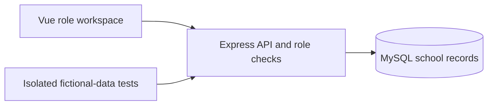

# StudentHub

A connected school workspace for Nepal middle and high schools. Administrators organise school records; teachers manage classes, homework and attendance; students find their lessons and published school information.

[Open StudentHub](https://team1-production.up.railway.app/) | [Start locally](docs/setup-guide.md) | [Week 13 evidence](classroom/week13/README.md) | [Final demo promise](classroom/final-demo-roadmap.md)

## Connected roles

| Role | Current workflow |
| --- | --- |
| Administrator | School/year/class setup, accounts, enrollment, subject/teacher assignments, timetables, floors/rooms, notices, activity log and data recovery |
| Teacher | Daily schedule, class roster, notices, homework/progress register, homeroom attendance/monthly summaries and canteen |
| Student | My Class with timetable/subjects, notices, current homework/history, canteen, profile and student card |
| Canteen head | Dated menus, prices, availability, drafts/publication, copy to days, hours/location |
| Parent - stretch | Verified child links, child homework/attendance/timetable and published notices/menu |

Teacher dashboard is core. Parent access and jobs remain stretch/optional. Week 13 keeps the final demo promise fixed.

## Evidence and current limits

- [Feature readiness](classroom/week13/final-feature-list.md), [current verification](classroom/week13/verification.md)
- [Earlier role screenshots](classroom/week12/bishal_check/README.md): historical evidence, not pictures of this release
- [Architecture/checks](docs/architecture.md), [single area map](classroom/week10/ai-use-and-code-ownership-audit.md#codebase-area-map--current-source-of-truth)

Local passing checks do not prove full live or physical-iPhone acceptance. A permanent empty-database baseline/first-admin procedure is absent from this checkout; the disposable demo is documented separately. An independent Week 13 reader trial remains required. [Actions and reminders](classroom/week13/issues-and-reminders.md).

## Run and test

Use PowerShell in the cloned repository root. Prerequisites: Git, Node.js 24/npm and local MySQL. The disposable demo needs permission to create/drop its own random database.

```powershell
npm.cmd ci --prefix backend
npm.cmd ci --prefix frontend
npm.cmd run build --prefix backend
npm.cmd run build --prefix frontend
npm.cmd test --prefix frontend
```

Follow the [setup guide](docs/setup-guide.md) for private configuration, a disposable demonstration, or two-terminal development with a provisioned database. No universal administrator password is published.

## Architecture



Railway builds the frontend/API into one service. Development Vite proxies `/api` to port 3000. [Dependencies and boundaries](docs/architecture.md).

| Location | Purpose |
| --- | --- |
| `frontend/src` | Vue workspaces and shared controls/styles |
| `backend/src` | API, authorization, transactions and schema helpers |
| `backend/tests`, `frontend/tests` | Automated checks |
| `database/migrations` | Historical migrations, not a full first-install baseline |
| `docs` | Current setup, architecture and feature guides |
| `classroom/week13` | Handoff report, evidence and reminders |

Keep `.env`, passwords, private exports and real student records out of GitHub. Use fictional demo data. [Deployment/recovery](docs/deployment.md).
