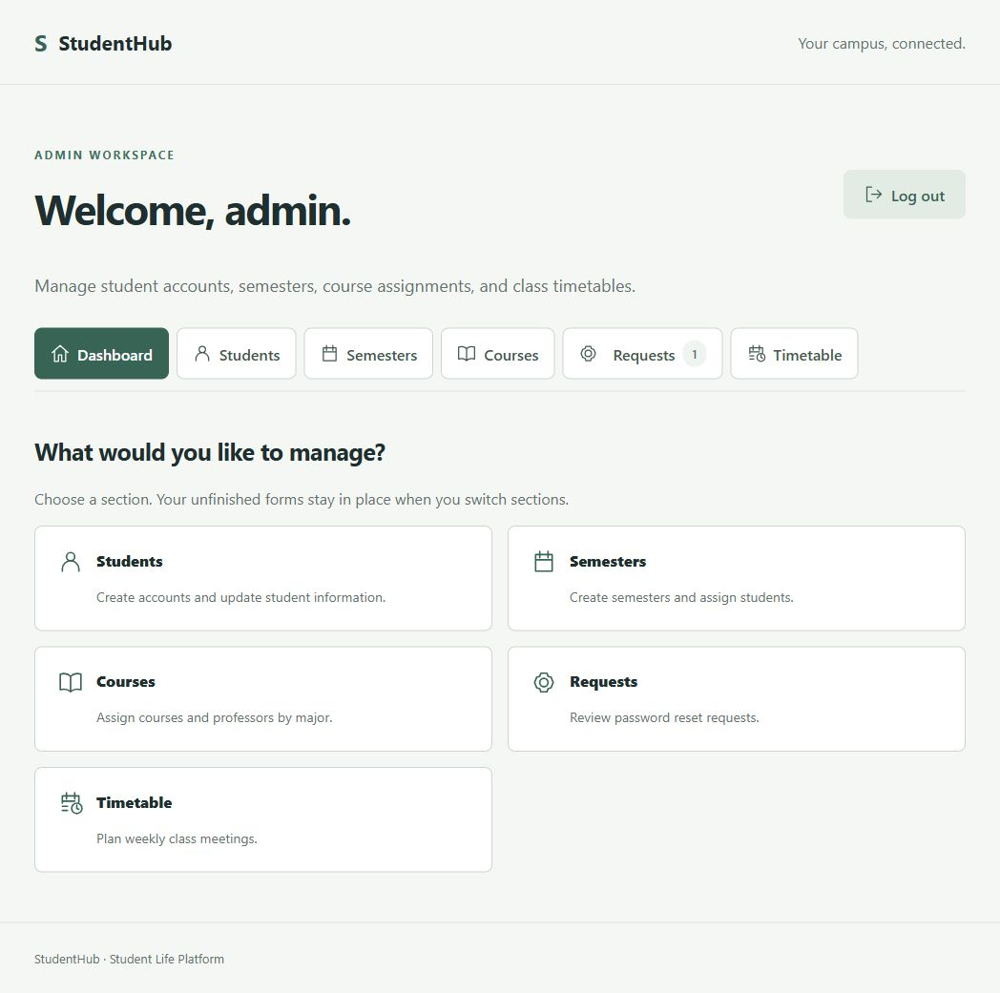
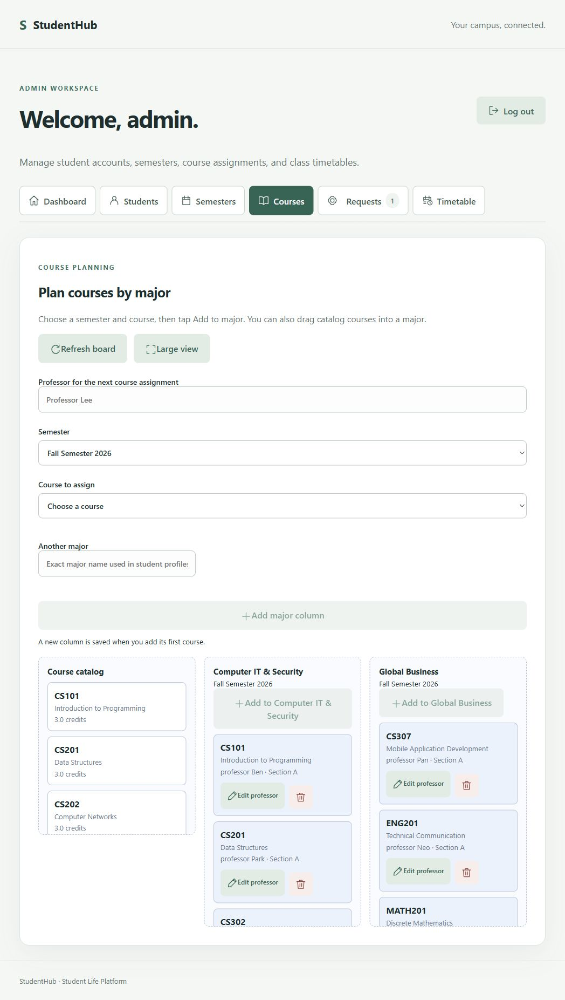
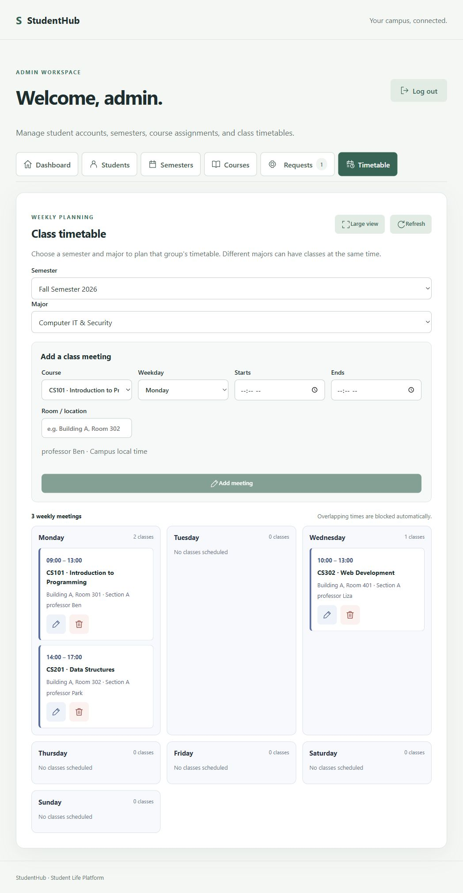

# StudentHub administrator screenshots

Captured from the deployed StudentHub application on October 17, 2026, using the signed-in administrator session. These are live interface captures, not mockups. No account, course, class meeting, semester, or password request was created, changed, or deleted for these screenshots.

Screenshots 02 and 08 are full-page captures requested by the project owner and include visible student records and request information. The student directory retains its normal internal scroll area. Screenshot 05 remains cropped before the student list. The empty account form contains no password or student details.

| Screen | Image |
|---|---|
| Dashboard | [01-dashboard.jpg](01-dashboard.jpg) |
| Student directory — full page | [02-student-directory-full.jpg](02-student-directory-full.jpg) |
| Blank student creation form | [03-create-student.jpg](03-create-student.jpg) |
| Semester directory, creation, and assignment controls | [04-semesters.jpg](04-semesters.jpg) |
| Fall semester details — header only, student list excluded | [05-semester-details-cropped.jpg](05-semester-details-cropped.jpg) |
| Fall semester course planning | [06-course-planning.jpg](06-course-planning.jpg) |
| Fall semester timetable — Computer IT & Security | [07-timetable.jpg](07-timetable.jpg) |
| Password requests — full page | [08-requests-full.jpg](08-requests-full.jpg) |

## Dashboard

## Courses

## Timetable

These screenshots demonstrate visible interface states; they do not by themselves prove database write or password-reset completion.
