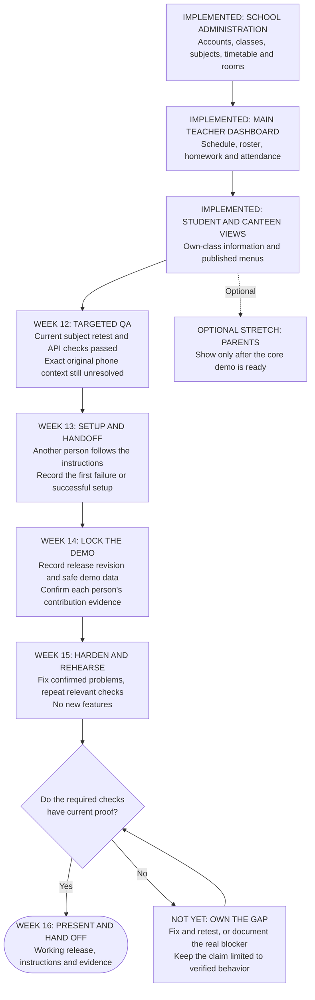

# StudentHub — Final Demo Roadmap

**Team:** Team 1 · **Last updated:** November 21, 2026  
**Coordinator:** Galan Bishal (@bishal482), with coding assistance  
**Source:** [Course Final Demo Roadmap template](https://github.com/CapstoneDesign-Fall2026-UlsanCollege/course-materials/blob/main/student-starter-kit/templates/final-demo-roadmap.md)

This shared roadmap carries the [project scope](../roadmap.md), [Week 11 freeze](week11/weekly-report.md#freeze-decision-and-next-route) and [Week 12 QA decision](week12/roadmap.md) into the final demo and handoff. It updates the route using current evidence; earlier weekly reports remain historical records. Future milestone dates follow the course template and are targets, not completed work.

## Final demo promise

> A Nepal middle/high-school administrator can organise a school, students, teachers, subjects and timetables; allocate classrooms and book special rooms without overlaps. Teachers can see their schedule and class roster, assign homework and record homeroom attendance. Students can see their own class information, lessons, homework and published school-canteen information.

**Who it helps and what problem it addresses:** school administrators, teachers, students and canteen staff who need clear, connected records instead of repeated manual lists.

**What the evidence will prove:** an identified release can complete the core role-to-role workflow, save and read back records after refresh, reject a conflicting room booking, keep student data scoped to the correct account, and hide unpublished menus. Another person can follow the setup and demo instructions.

**What the demo will not claim:** all school policies are enforced, every device has passed, or the app is production-ready merely because automated tests pass. Parent accounts/dashboard remain **stretch**. High-school jobs remain optional, with access-gating work separate from the core promise. No new features are planned during the freeze.

## Current state

**MVP progress: Gap to close.** Core features are implemented and have local automated evidence; complete independent/live acceptance and clean handoff are not yet established. [Week 11 recovery path](week11/weekly-report.md#risks-blockers-and-work-priority).

| Status | Behavior, quality, or handoff item | Evidence | Still uncertain |
| --- | --- | --- | --- |
| Working in tested scope | School structure, accounts, subject/teacher planning, rooms and cross-role reads | [Daily workflow](week11/daily-workflow.md), [implementation index](week11/README.md) | Full independent live role workflow on one recorded release |
| Working in tested scope | Special-room save/refresh and overlap rejection on deployed iPhone | [Ansh's room test](week11/ansh-room-booking-iphone-test.md) | Other devices/conditions and later revisions |
| Partial | Phone subject persistence | [Original failure](week11/ansh-iphone-subject-persistence.md), [current peer pass](week12/ansh-subject-persistence-retest.md), [API check](week12/galan-qa-result.md) | Peer pass used a different subject/teacher. Original deployed combination/context still needs comparison; #83 stays open |
| Partial — main release | Teacher schedule, roster, homework and monthly homeroom attendance | [Teacher checks](week10/teacher-workspace-check.md), [monthly totals](week10/monthly-attendance-check.md) | Independent hosted save/read-back and authorization checks |
| Partial | Canteen draft/publish, sold-out/restore and withdrawal | [Bal Raju's recorded work and remaining browser plan](week11/coderraaju-individual-assignment.md) | Independent hosted browser write/read-back sequence; agreed safe fixture |
| Partial | Railway deployment and school data | [Deployment record](week11/railway-deployment-2026-11-12.md), [migration proof](week11/railway-data-migration-2026-11-12.md) | Full authenticated acceptance tied to exact deployed revision, not merely a loading page |
| Not yet verified independently | Fresh-clone/empty-database setup and handoff | [Setup issue #77](https://github.com/CapstoneDesign-Fall2026-UlsanCollege/Team1/issues/77) | Another person follows written setup without coaching |
| Partial — stretch | Parent dashboard and verified child links | [Parent workspace](week11/parent-workspace.md) | Further independent/phone acceptance; does not block the main demo |

## Route at a glance

Read top to bottom. Labels state the status; colour is not needed to understand the route.

## Lessons that change our route

| Lesson | Source | What changes |
| --- | --- | --- |
| Week 12 requires one evidence-led QA loop, not new scope or a repeated full MVP gate | [Course requirements](https://github.com/CapstoneDesign-Fall2026-UlsanCollege/course-materials/blob/main/week-12/one-pager.md) | Follow #83 through a discriminating check; keep feature scope frozen |
| A passing different-combination retest does not erase an earlier failure | [Ansh's comparison](week12/ansh-subject-persistence-retest.md#comparison-with-week-11) | Preserve original proof and compare deployed context before closure |
| A successful API restart test does not verify phone gestures or browser state | [Actual isolated result](week12/galan-qa-result.md) | Keep assistant, peer, local and hosted claims separate |
| Teacher work is core; parent work is stretch | [Recorded scope decision](../roadmap.md#teacher-dashboard--main-release) | Rehearse teacher homework/attendance before optional parent demonstration |

## Roadmap milestones

Galan owns coordination below. Named teammate testing roles are **proposed unless their linked receipt already records execution**; nobody's future commitment or personal explanation is asserted on their behalf. The [single shared area map](week10/ai-use-and-code-ownership-audit.md#codebase-area-map--current-source-of-truth) and [Week 11 review](week11/ai-use-and-code-ownership-audit.md) hold detailed support boundaries, rather than duplicating them here.

| Week / class date | Milestone result and check | Delivery owner(s) | Affected area / support | Evidence or planned evidence | Dependency, risk or fallback |
| --- | --- | --- | --- | --- | --- |
| 10 / Nov 5 — ownership and AI audit | **Recorded:** implementation/evidence and code-area map exist. **Pending:** each member confirms explanation and backup | Galan coordinates; each member confirms self | School API, admin/student frontend, canteen, teacher workspace; shared map | [Week 10 audit](week10/ai-use-and-code-ownership-audit.md) | Written receipts are not oral understanding or teammate sign-off |
| 11 / Nov 12 — MVP verification and freeze | **Recorded Nov 18:** feature scope frozen; recovery/acceptance chosen. Keep confirmed failures and acceptance gaps visible | Galan coordinates; Ansh/Bal Raju/Buddha own their recorded evidence | Core cross-role workflow | [Shared report](week11/weekly-report.md), [MVP checks](week11/mvp-verification.md) | Automated passes do not replace human/live acceptance |
| 12 / Nov 19 — QA and triage | **Partial:** current iPhone combination and API boundary passed. By Nov 25, record exact-context check or actual blocker; no speculative fix | Galan; proposed peer follow-up Ansh | Planner → school API → MySQL; consult shared map | [Checklist](week12/qa-checklist.md), [result](week12/galan-qa-result.md), [report](week12/weekly-report.md), #83 | If production fixture/IDs are unavailable, record that limitation and recovery owner; retain original failure |
| 13 / Nov 26 — setup and handoff | **Planned:** a non-author clones the recorded revision, configures an isolated empty DB, creates first admin and completes one documented task without a walkthrough; record first failure if blocked | Galan prepares; another member to confirm tester role | Setup, schema/migrations, config, release entry points | Planned `week13/handoff-trial.md` with revision, commands, expected/actual and safe proof; [#77](https://github.com/CapstoneDesign-Fall2026-UlsanCollege/Team1/issues/77) | Use fictional DB and private credentials. A hosted walkthrough is a limited fallback, not proof of clean setup |
| 14 / Dec 3 — demo and contribution lock | **Planned:** identify release commit, freeze fixture/demo order, record required role acceptance and member-confirmed contribution links | Galan coordinates; each member confirms own evidence | Core roles and deployment; stewards review affected boundaries | Planned `week14/demo-lock.md`, shared report and release/CI links; [#60](https://github.com/CapstoneDesign-Fall2026-UlsanCollege/Team1/issues/60) | Unmet required checks remain explicit. Omit optional parent/jobs demo before weakening core checks |
| 15 / Dec 10 — hardening/readiness | **Planned:** rehearse the locked revision, fix confirmed failures only and rerun affected checks; verify backup/recovery instructions | Galan coordinates; non-author retester to confirm | Only affected runtime areas and deployment; consult map for fixes | Planned `week15/readiness.md`, fix/retest links and rehearsal note | No new scope. A recording may support an outage fallback if allowed, but cannot be called a live pass |
| 16 / Dec 17 — presentation/handoff | **Planned:** demonstrate the recorded core path and provide setup, limitations, release revision, evidence index and confirmed contributions | Whole team; Galan coordinates | Presentation and repository handoff | Planned `week16/final-handoff.md`, release tag/commit and final shared report | State any remaining limitation; share credentials privately, never in slides or repo |

Planned evidence paths above are destinations, not existing proof. Create them after actual work; do not make empty pass receipts.

## Next one or two weeks

| Issue or action | Owner | Done when | Evidence path |
| --- | --- | --- | --- |
| #83 exact-context persistence follow-up, by Nov 25 | Galan coordinates; peer to confirm | Revision and school/year/class/term/subject/teacher identities are recorded around refresh; result has safe proof and an evidence-backed disposition | [Week 12 QA checklist](week12/qa-checklist.md), [#83](https://github.com/CapstoneDesign-Fall2026-UlsanCollege/Team1/issues/83) |
| #77 non-author setup/handoff, Week 13 | Galan prepares; tester to confirm | Another person attempts the written fresh-clone/empty-DB path and reports actual first failure or success | Planned `week13/handoff-trial.md`; issue #77 |
| Hosted core acceptance, before demo lock | Galan coordinates; reviewers to confirm | Admin/room conflict → teacher homework/attendance → student read-back and canteen privacy/availability all checked on one identified release | [#60](https://github.com/CapstoneDesign-Fall2026-UlsanCollege/Team1/issues/60), [#65](https://github.com/CapstoneDesign-Fall2026-UlsanCollege/Team1/issues/65); planned Week 13/14 actual notes |
| Canteen independent browser follow-up | Galan coordinates with proposed tester Bal Raju | Agreed fictional menu draft is private, publication appears, sold-out/restore persists, withdrawal hides it, fixture restored | [Existing procedure](week11/coderraaju-individual-assignment.md#repeatable-test-steps), #54/#56 |
| Contribution and support confirmations | Each member | Each adds/confirms their own work/evidence and explains the relevant check | [Shared Week 12 report](week12/weekly-report.md#individual-entries--confirmation-status-explicit), shared area map |

## Top risks

P-level is work order; severity describes an observed defect. Verification gaps have no invented bug severity.

| Risk | Why it matters | Owner | Response or fallback | Review |
| --- | --- | --- | --- | --- |
| P1 clean setup/handoff gap | A new person may be unable to run the app | Galan; non-author tester pending | #77 isolated setup trial; fix the first actual failure and repeat | Week 13 |
| P1 full hosted core acceptance gap | Loading HTML does not establish permissions and saved data behavior | Galan coordinates | Tie role checks to release revision and approved fixture; retain incomplete gate if blocked | Weeks 12–14 |
| P2 #83 reliability follow-up; historical Major severity | Earlier phone assignment disappeared after refresh despite current scoped passes | Galan | Exact-context comparison; do not infer a cause or close solely from different-combination/API passes | Week 12, Nov 25 |
| Hosted canteen fixture is shared | Test writes could interfere with a real published menu | Galan; operator/tester confirms window | Use an agreed fictional fixture; stop if only real active content is available | Weeks 12–13 |
| Contribution/support confirmations missing | Handoff cannot depend entirely on one person or assistant-written prose | Each member | Personal entries and explanations; do not claim proxy human work | Weeks 12–14 |
| Hosting outage or later deployment changes | Prior proof may no longer describe the release being shown | Galan | Record deployed revision, rehearse, retain approved backup evidence and recovery procedure | Weeks 14–16 |

## Progress check

- [x] Route begins with linked current evidence and preserves older failures.
- [x] Promise matches the checks planned for final acceptance.
- [x] Each milestone has a result, coordinator/owner, check and evidence destination.
- [x] Affected areas/support paths link the shared area map; no exclusive file ownership is imposed.
- [x] Week 11 records the MVP gap and feature-freeze decision.
- [x] Week 13 plans another person's setup/handoff trial; execution is pending.
- [x] Week 14 plans demo and contribution lock; execution is pending.
- [x] Week 15 is hardening/readiness, not new scope.
- [ ] Every member has personally confirmed their current shared-report entry and support role.
- [ ] Required independent/live checks and handoff have passed for the final release.

**AI-use note:** Codex read the course template and existing repository records and drafted this roadmap at Galan's request. Future commitments, human checks, dates of execution and team sign-off are not invented. Update the route when new evidence changes risk, fallback or the next action.

## Week 13 checkpoint — November 28, 2026

The promise remains unchanged. [Reader package](week13/README.md), [feature status](week13/final-feature-list.md) and [verification](week13/verification.md) now link current scope. Independent non-author trial remains pending in [Peer Test Notes](week13/peer-test-notes.md). Permanent baseline/first-admin route is absent from this checkout despite historical #77 closure; no permanent-install fallback is verified. Galan coordinates evidence reconciliation and a reader result by December 2 end of day. [Actions/Definitions of Done](week13/issues-and-reminders.md).
