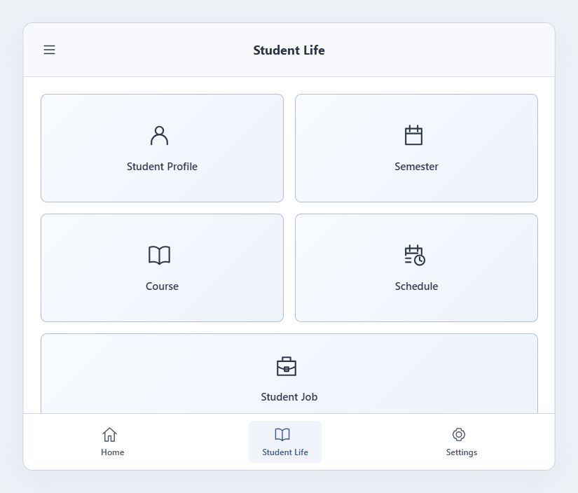
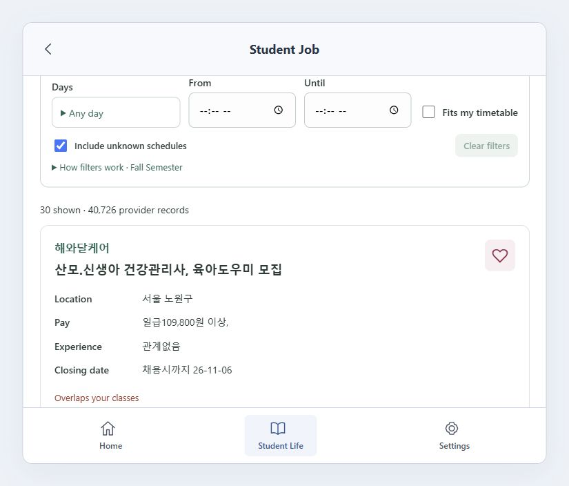
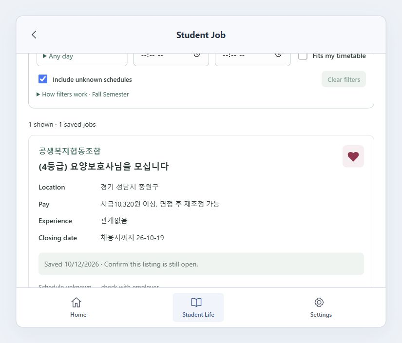

# StudentHub student screenshots

Live student interface captures collected on October 17–18, 2026 from the Railway deployment. The profile screenshot was added on October 18 at the user's explicit request, including the displayed contact details and student ID.

Screenshots 02, 05, 06, and 07 use taller capture viewports requested by the user; the normal browser size was restored afterward. The application scrolls inside its student content panel. Additional scrolled captures show the timetable, filters, and saved-job information below the initial view. Images retain the normal header and bottom navigation. No profile fields, saved jobs, or academic records were modified for these captures.

| Screenshot | View |
|---|---|
| [01-student-life.jpg](01-student-life.jpg) | Student Life service menu |
| [02-student-profile.jpg](02-student-profile.jpg) | Full profile, added at the account owner's request |
| [03-semesters.jpg](03-semesters.jpg) | Assigned semester and dates |
| [04-courses.jpg](04-courses.jpg) | Courses and professors |
| [05-timetable.jpg](05-timetable.jpg) | Taller complete weekly timetable and semester selector |
| [06-job-search.jpg](06-job-search.jpg) | Taller job search capture, including filters and initial job listings |
| [07-favourites.jpg](07-favourites.jpg) | Taller Favourites capture with the saved job and application/contact actions |
| [08-saved-job-card.jpg](08-saved-job-card.jpg) | Existing saved job with selected heart |
| [09-saved-job-actions.jpg](09-saved-job-actions.jpg) | Schedule label and employer application/contact actions |
| [10-job-filters-results.jpg](10-job-filters-results.jpg) | Compact availability filters and provider result |
| [11-timetable-meetings.jpg](11-timetable-meetings.jpg) | Scheduled Monday and Wednesday meetings |
| [12-timetable-lower-week.jpg](12-timetable-lower-week.jpg) | Remaining days in the weekly timetable |

## Student Life

## Job filters and listings

## Saved job

These images document visible live interface states. They do not claim that a new job was saved, a phone call was made, or an application was submitted during capture.
