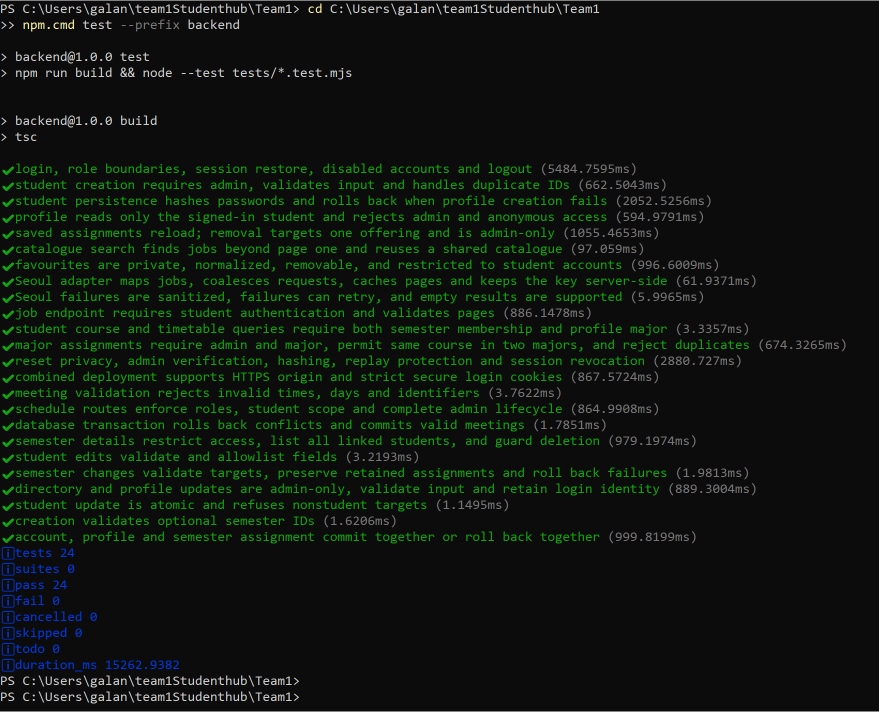

# Week 7 Test Report

**Team:** Team 1 — StudentHub

**Recorded:** October 17, 2026

**Reported by:** Galan Bishal

## Automated backend tests — passed

- Command: `npm.cmd test --prefix backend`, from the repository root in PowerShell.
- Expected result: all backend tests pass.
- Actual result visible in the screenshot: **24 tests, 24 passed, 0 failed**.
- Coverage includes authentication, roles, profiles, courses, schedules, job search, favourite ownership, password resets, and semester-detail deletion guards.

[Open the original screenshot](test_result.png) · [Test files](https://github.com/CapstoneDesign-Fall2026-UlsanCollege/Team1/tree/main/backend/tests)

## Midterm preparation — reported passed

Galan confirmed that the midterm-preparation checks previously listed as a risk were tested and passed. This result is reported by the user; this documentation update did not run another rehearsal or independently measure its duration.

- Expected: the prepared demonstration can be followed successfully.
- Actual: passed, as reported by Galan on October 17.
- [Verification record #52](https://github.com/CapstoneDesign-Fall2026-UlsanCollege/Team1/issues/52) · [Preparation #46](https://github.com/CapstoneDesign-Fall2026-UlsanCollege/Team1/issues/46) · [Demo script](../week7/midterm-demo-script.md)

## Live semester deletion and cross-device favourites — reported passed

- Expected: a controlled semester-deletion check succeeds, and a saved favourite remains available when signing in on another device.
- Actual: both checks passed, as reported by Galan on October 17.
- [Verification record #53](https://github.com/CapstoneDesign-Fall2026-UlsanCollege/Team1/issues/53) · [Semester implementation #50](https://github.com/CapstoneDesign-Fall2026-UlsanCollege/Team1/issues/50) · [Favourites #48](https://github.com/CapstoneDesign-Fall2026-UlsanCollege/Team1/issues/48)

The screenshot above proves the automated test result. It is not a screenshot of live deletion, another device, or rehearsal timing. No non-author tester identity is assumed.
