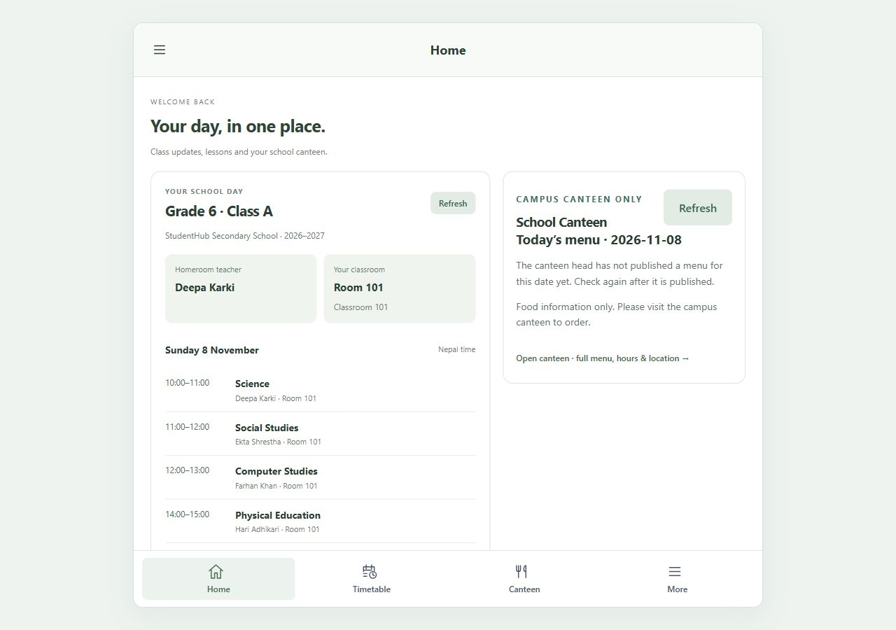
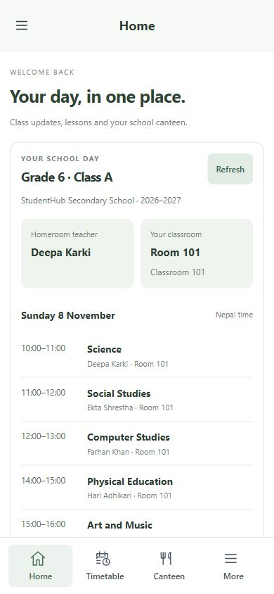
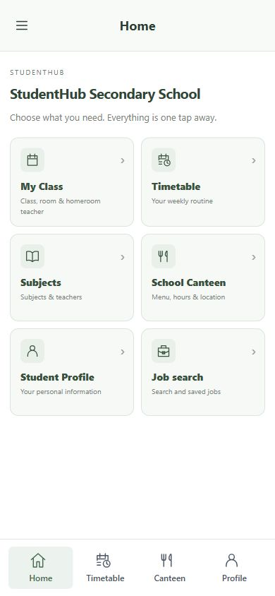
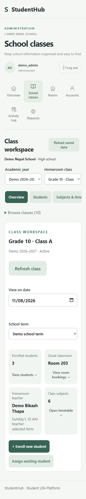
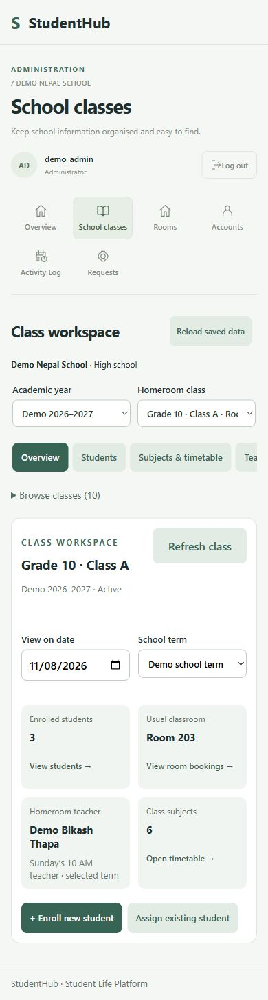
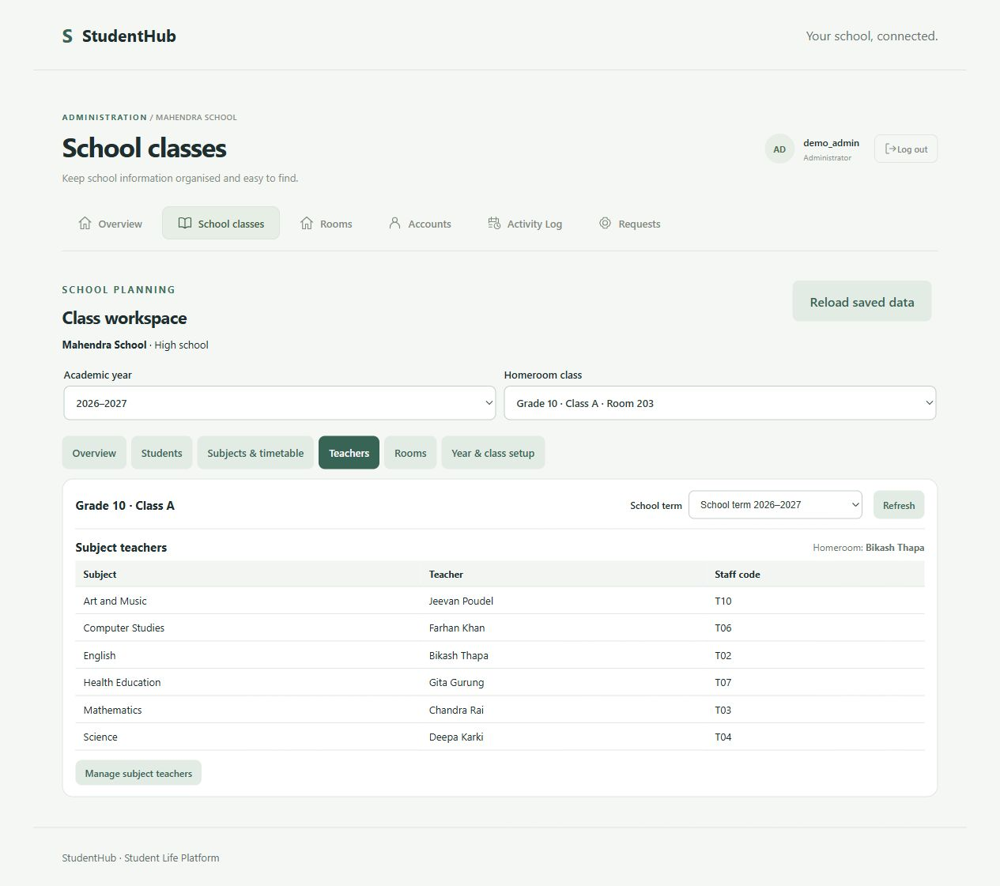
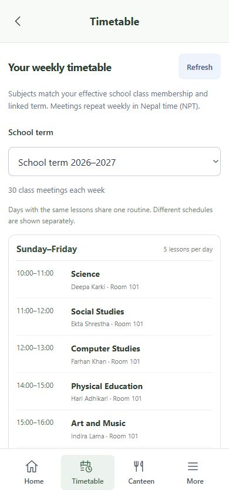

# Week 10 — Individual Testing Evidence

**Name:** Buddha Raj Giri  
**GitHub ID:** BudhaRajgiri  
**Team:** Team 1  
**Project:** Student Life Hub  
**Week:** 10  
**Date:** 2026-11-10  
**Assigned feature:** #68 — Student My Class View

## 1. Testing Objective

Verify that students can view their own school year, grade, homeroom class, classroom, assigned teacher, and weekly timetable correctly.

## 2. Test Results

| No. | Test | Expected Result | Actual Result | Status |
|---|---|---|---|---|
| 1 | Home page | Home page and feature tabs load | Home page loaded successfully | Passed |
| 2 | My Class | Correct school year and grade appear | My Class page displayed the student's information | Passed |
| 3 | Own class | Correct homeroom and classroom appear | Class A and its classroom information displayed correctly | Passed |
| 4 | Teacher | Correct assigned teacher appears | Demo Teacher Kim appeared as the assigned teacher | Passed |
| 5 | Missing teacher | No teacher is invented if unassigned | Class B, Classroom 102 displayed; teacher correctly shown as unassigned | Passed |
| 6 | Privacy | Cannot access another student's class information | Interface displayed only the logged-in student's class information | Passed — UI check |
| 7 | Timetable | Weekly routines and days appear correctly | Science appeared Sunday, 10:00–11:00, Classroom 102 | Passed |
| 8 | Home navigation | Home and feature tabs work correctly | Home and My Class navigation worked successfully | Passed |

## 3. My Class Screenshot Evidence

The following screenshots are stored in this same evidence folder in the repository.

### Student Home Page

### My Class Workspace

### Class Teacher and Timetable

## 4. Frontend, Backend, and Database Test Logs

The links below open the actual test log files committed in this GitHub evidence folder.

### 4.1 Frontend Tests

- [Frontend test log — 10 passed, 0 failed](frontend-2026-11-05.txt)
- [Frontend production build log — successful](frontend-build-2026-11-05.txt)

### 4.2 Backend Tests

- [Backend test log — 38 passed, 0 failed, 2 skipped](backend-2026-11-05.txt)

### 4.3 School MySQL Integration Tests

- [School MySQL test log — 17 passed, 0 failed](school-mysql-2026-11-05.txt)

### 4.4 Supporting Test Summary

| Test Category | Passed | Failed | Skipped |
|---|---:|---:|---:|
| Frontend | 10 | 0 | 0 |
| Frontend production build | Successful | — | — |
| Backend | 38 | 0 | 2 |
| School MySQL integration | 17 | 0 | 0 |

**Date note:** The frontend, backend, build, and school MySQL logs above are dated November 5, 2026. They are supporting project-level test evidence, not new tests run on November 10 and not proof that every Week 10 My Class test was covered by those logs.

## 5. Problems Found

- The disposable review database was removed when the review server stopped. Test data had to be recreated after restarting the server.
- The classroom and missing-teacher test records needed to be prepared manually in the disposable review database.
- Privacy was checked through the visible student interface. Backend authorization against a direct unauthorized request still needs separate verification.

## 6. Next Actions

- Keep the relevant screenshots and test logs in this evidence folder.
- Report any additional bugs found during team review.
- Continue checking the backend privacy restrictions with a direct unauthorized request.

## 7. Testing Summary

**My Class feature:** 8 of 8 planned interface tests completed successfully.

**Supporting project tests:**
- Frontend: 10 passed, 0 failed.
- Frontend production build: successful.
- Backend: 38 passed, 0 failed, 2 skipped.
- School MySQL integration: 17 passed, 0 failed.

The student-facing My Class view displayed the tested class information, classroom, assigned or unassigned teacher state, and timetable.

**Testing note:** The privacy result confirms visible interface behavior only; it does not claim an independent backend authorization test.

**Evidence owner:** BudhaRajgiri
