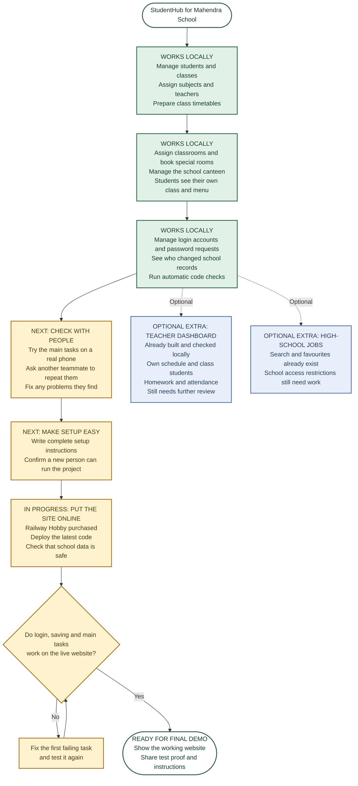

# StudentHub — current project roadmap

**Team:** Team 1 · **School:** Mahendra School  
**Updated:** November 12, 2026 · **Owner:** Galan Bishal, with coding assistance  
**Direction:** Nepal middle/high-school administration. This supersedes the [Week 9 plan](../week9/roadmap.md) and [Week 10 checkpoint](../week10/roadmap.md).

## Project flowchart

Read from top to bottom. Each arrow means **the next step**. Green boxes already work on our laptop; yellow boxes still need finishing; blue boxes are optional. Text labels carry the same meaning as the colours.

**Teacher dashboard is stretch work.** It stays separate from the main route to the final demo. The administrator's teacher list and subject planning remain part of the main project.

**Current position:** the main features work locally. Real-phone/teammate checks, easy setup and live verification are still needed. Railway Hobby has now been purchased; deployment is in progress, not yet confirmed successful.

<strong>Open technical details, evidence and issue links</strong>

## Completed implementation

| Area | What exists now | Evidence / issues |
|---|---|---|
| School structure | Academic years, grades/classes, dated membership and transfers with explicit legacy mapping | [School checks](../week10/school-release-check.md), #66 |
| Student accounts | Class-aware creation; compact combined profile/login editor, automatic admission-ID prefix, individual ID change without changing password or linked records | [Account checks](../week10/student-login-id-check.md), #74/#82 |
| Academic planning | Admin teacher directory, staff IDs, subject filter, subject/teacher assignment, Sunday–Friday timetable and recorded conflicts | [School workspace](../week10/school-workspace-usability.md), #62–64/#75 |
| Homeroom display | Derived from the selected term's Sunday 10 AM teacher, shown to admin/student; ambiguity and missing assignment are explicit | [Student checks](../week10/student-dashboard-check.md), #67/#68/#76 |
| Rooms | Five floors / 40 rooms, usual classroom assignments, same-day special-room bookings and room/class/teacher conflicts | [Room verification](../week10/room-booking-assistant-check-2026-11-10.md), #72 |
| School canteen | Separate canteen-head account/workspace, menus, rupee prices, selected-date copying, skip existing dates, publication, hours/location and availability | [Canteen proof](../week10/canteen-owner-check.md), [shortcuts](../week10/canteen-menu-shortcuts-check.md), #54–56/#61 |
| Student experience | Feature-tab Home, own class/teacher/room, grouped repeated timetable and published canteen information | [Student proof](../week10/student-dashboard-check.md), #76 |
| Support and history | Administrator-reviewed password requests with private manual delivery; staff Activity Log with sensitive-value redaction | [Activity Log proof](../week10/activity-log-check.md), #49/#73 |
| Testing | Existing node:test runner, local tests/builds, controlled failure check and GitHub Actions | [Week 11 testing guide](automated-testing-guide.md), [CI proof](testing-evidence.md), #84 closed |
| Mobile follow-up | Tap-to-assign subjects, Add lesson without drag, compact text; successful 390px assignment/save/reload and 320px dialog fit | [Actual verification](issue-verification-2026-11-12.md), #83 physical-phone check pending |

The original separate manual homeroom assignment/history design is **not** implemented by the timetable-derived display. Teacher specialization and the repeated five-period routine are current sample-data choices, not a fully enforced national curriculum or qualification policy.

## What we will finish next

| Priority | Work and definition of finished | Owner | Issue |
|---|---|---|---|
| 1 | Repeat subject assignment, popup save/cancel, conflict handling and normal scrolling on a physical phone; record device/browser, commit and actual results | Galan Bishal | [#83](https://github.com/CapstoneDesign-Fall2026-UlsanCollege/Team1/issues/83) |
| 1 | A real non-author repeats a valid room booking and overlap rejection; verify own-class isolation and canteen publication privacy; record expected/actual and safe proof | Galan coordinates; tester must personally confirm | [#72](https://github.com/CapstoneDesign-Fall2026-UlsanCollege/Team1/issues/72), #60 |
| 1 | Review remaining feature criteria, configured school data, hours/prices, inactive/missing states and recovery behavior; fix observed failures rather than assume tests cover every screen | Galan + school/canteen operator confirmation | #54–56/#62–68/#70/#73–76/#82 |
| 2 | Publish baseline/migration order and private configuration, first-admin steps; reproduce from a clean clone and empty isolated database | Galan Bishal | [#77](https://github.com/CapstoneDesign-Fall2026-UlsanCollege/Team1/issues/77) |
| 3 | Confirm hosting decision, back up/verify data, deploy a recorded commit, and prove authentication, permissions and saved read-back on the live URL | Galan Bishal | [#65](https://github.com/CapstoneDesign-Fall2026-UlsanCollege/Team1/issues/65) |
| 4 | Rehearse the core demo, update one shared report and confirmed personal contributions, document remaining limitations, and publish final release evidence | Team members confirm their own parts; Galan coordinates | [#60](https://github.com/CapstoneDesign-Fall2026-UlsanCollege/Team1/issues/60) |

Hosting preparation can proceed alongside local QA/setup. Galan confirmed the Railway Hobby purchase on November 12. Deployment and database verification are in progress. The earlier November 12 HTTP check returned **404**; it is historical evidence, not proof of the next deployment. A Pages build alone is not a working backend deployment.

## Stretch section — teacher dashboard

**Moved here at Galan's request on November 12.** Preserve the existing code and records. The core school-administration release does not depend on finishing this extension. Admin-side teacher records and timetable planning remain core.

| Stretch feature | Current state | Before claiming final completion |
|---|---|---|
| Teacher accounts, personal schedule and assigned-class roster (#78) | Implemented and locally checked | Independent/hosted role and isolation check |
| Teacher homework and student homework view (#79) | Implemented and locally checked | Non-author create/edit/archive and student read-back |
| Homeroom attendance (#80) | Implemented and locally checked | Non-author authorization, save and reload |
| Monthly attendance register (#81) | Implemented and locally checked; O present, X absent, - late; adjusted absence adds floor(lates/3) within month | Independent review of totals, membership/date boundaries and live persistence |

[Teacher evidence](../week10/teacher-workspace-check.md) · [Monthly attendance evidence](../week10/monthly-attendance-check.md). No original late marks are rewritten. No claim that this stretch is unbuilt, removed or independently accepted.

## Optional high-school feature

Job search, filters and favourites already exist. [#69](https://github.com/CapstoneDesign-Fall2026-UlsanCollege/Team1/issues/69) still needs server-enforced high-school/setting access controls. Retain code/data; do not present this as an approved middle-school workflow or a blocker to the administration demo.

## Final core demo path

1. Administrator opens a grade/class, reviews students, teacher assignments and weekly timetable.
2. Saves a valid special-room booking, reloads it and shows a conflicting booking rejected.
3. Student opens their own class, homeroom teacher, timetable and published canteen menu.
4. Canteen head changes approved fictional menu availability; student refresh confirms it.
5. Show the exact test/CI and human proof, followed by live results when hosting is restored. Demonstrate the teacher dashboard only as an optional extension if time allows.

## Current evidence and limits

The [November 12 verification](issue-verification-2026-11-12.md) records 78 backend passes with all isolated DB suites enabled, 17 frontend passes, successful build, actual phone-width subject save/reload/conflict checks and the live 404. These are assistant-run local checks. Physical-phone, independent teammate and hosted acceptance remain distinct. An implemented feature may still have an open issue because its remaining acceptance criteria are not met.

