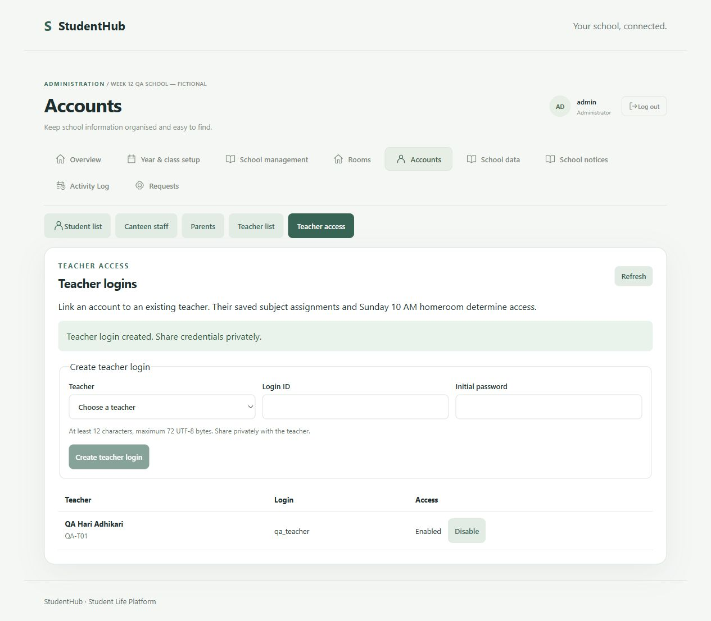

# Administrator — setup guide and test evidence

**Recorded run:** November 21–22, 2026 · **Runner:** Codex at Galan Bishal's request.  
[All roles](README.md) · [Full report](report.md) · [Teacher](teacher.md) · [Student](student.md) · [Canteen head](canteen-head.md) · [Parent](parent.md)

## Responsibility and starting state

Administrators configure the school, academic structure, rooms, people and login access. Canteen content is managed by the canteen head; teaching tasks belong to the teacher.

This walkthrough began at `http://127.0.0.1:3033/` with one admin and no school records. Use privately supplied credentials. [Initial counts](evidence/initial-counts.json). All names, identities and records below are fictional. The preserved local database is separate from Railway and the existing school.

## Steps from first login

1. Sign in and open **Year & class setup**. Save the school name/level, academic year, term and first class in that order. The run created Week 12 QA School — Fictional, 2026–2027 QA, QA First Term and Grade 6 A.
2. Open **Rooms → Add floor**. Create the floor and room batch. Tap a room to name it or change its type. Assign Room 101 as the class's usual room; Room 102 was made QA Science Lab.
3. Open **School management → Subjects & timetable → Manage subject library**. Create Moral Education (QA-MORAL) for Grade 6.
4. Open **Accounts → Teacher list → Create teacher**. Save QA Hari Adhikari, staff code QA-T01, with Moral Education. Under **Teacher access**, create and link the teacher login. Share credentials privately.
5. Return to the class planner. Select the library subject, choose its teacher and confirm. Reload the page and reopen the same class/term to verify it remains. Tap the subject name to save its Sunday–Friday 10:00–11:00 routine in Room 101.
6. Under **Accounts → Student list → Create student account**, choose year/grade/class and enter student number. The account and membership save together; this run generated fictional login 26061001 for QA Aarav Example. Create qa_canteen under **Canteen staff**.
7. In **Rooms**, select the class and the special room. Review the subject, supervising teacher, same-day date/times and save. Refresh rooms and inspect read-back. This run's second overlapping conditions had no available supervisor and Save was disabled.
8. Review **Activity Log** for attribution. Create a fictional parent only after reviewing its test guardian/child link, then publish a dated notice under **School notices**. Parent consumption is shown in the parent guide.
9. Add another class/grade when needed. Grade 7 B and QA Science were added for the catalogue-switch/mobile-list check. In portrait view, **Show list / Hide list** controls the extra subject list.
10. Review Overview, restart the server without resetting its database and sign in again. Retained records must remain readable.

## Actually observed and limits

School setup, linked assignment/reload, six weekly lessons, account creation, usual-room allocation, special-room read-back, parent creation, notice publication and audit display worked in the recorded scope. The overlap picture is UI prevention, not proof of a submitted server conflict rejection. Grade 7 B is intentionally left unallocated; Overview correctly reports remaining work for it.

[Final SQL read-back](evidence/final-readback.json) and [post-restart role checks](evidence/post-restart-role-reads.txt) support persistence. Non-admin access to the school admin endpoint returned 403; anonymous access returned 401. This is not a fresh-clone, real-phone or full production acceptance pass.

## Screenshot sequence

| Original step | Acting role | Observed screen/action | Screenshot |
| --- | --- | --- | --- |
| 1 | Admin | Admin empty start | [Picture 01](evidence/01-admin-empty-start.jpg) |
| 2 | Admin | School saved | [Picture 02](evidence/02-school-saved.jpg) |
| 3 | Admin | Academic year saved | [Picture 03](evidence/03-academic-year-saved.jpg) |
| 4 | Admin | Term saved | [Picture 04](evidence/04-term-saved.jpg) |
| 5 | Admin | Class created | [Picture 05](evidence/05-class-created.jpg) |
| 6 | Admin | Floor and rooms | [Picture 06](evidence/06-floor-and-rooms.jpg) |
| 7 | Admin | Grade 6 A assigned to usual room 101 with separate science lab | [Picture 07](evidence/07-classroom-assigned.jpg) |
| 8 | Admin | Moral Education created in Grade 6 subject library | [Picture 08](evidence/08-subject-library-created.jpg) |
| 9 | Admin | Teacher with specific teaching subject saved | [Picture 09](evidence/09-teacher-record-created.jpg) |
| 10 | Admin | Teacher login linked to the teacher record; form cleared | [Picture 10](evidence/10-teacher-login-created.jpg) |
| 11 | Admin | Moral Education with fictional teacher ready to confirm | [Picture 11](evidence/11-subject-assignment-form.jpg) |
| 12 | Admin | Class subject and teacher saved | [Picture 12](evidence/12-subject-saved.jpg) |
| 13 | Admin | Moral Education assignment still present after actual page reload | [Picture 13](evidence/13-subject-after-reload.jpg) |
| 14 | Admin | Sunday-Friday 10-11 routine saved | [Picture 14](evidence/14-weekly-routine-saved.jpg) |
| 15 | Admin | Fictional student enrolled with generated login 26061001 | [Picture 15](evidence/15-student-created.jpg) |
| 16 | Admin | Canteen head account created by admin | [Picture 16](evidence/16-canteen-account-created.jpg) |
| 17 | Admin | Saved same-day lab booking visible after refreshed room data | [Picture 17](evidence/17-booking-readback.jpg) |
| 18 | Admin | Second request at saved time has no available supervisor and save disabled | [Picture 18](evidence/18-overlap-prevented.jpg) |
| 19 | Admin | Audit lists actions performed in the new fictional school | [Picture 19](evidence/19-admin-activity-log.jpg) |
| 39 | Admin | Fictional guardian linked to the child with admin verification | [Picture 39](evidence/39-parent-created.jpg) |
| 50 | Admin | Admin publishes fictional school notice for today | [Picture 50](evidence/50-admin-notice-published.jpg) |
| 54 | Admin | Second class Grade 7 B added without disturbing Grade 6 A | [Picture 54](evidence/54-second-class-created.jpg) |
| 55 | Admin | New school Grade 6 extra-subject list starts collapsed at 390px | [Picture 55](evidence/55-mobile-list-collapsed.jpg) |
| 56 | Admin | Explicit Show list reveals QA Science from another grade | [Picture 56](evidence/56-mobile-list-expanded.jpg) |
| 57 | Admin | Hide list closes the extra catalogue again | [Picture 57](evidence/57-mobile-list-hidden-again.jpg) |
| 58 | Admin | Final admin overview after full new-school role walkthrough | [Picture 58](evidence/58-admin-final-overview.jpg) |
| 59 | Admin | Admin signs in after server restart with saved school data still present | [Picture 59](evidence/59-after-server-restart.jpg) |

These links reuse the existing recorded run; writing this guide did not execute a new test. Cross-role rows identify the actual acting/reading role rather than attributing all actions to this guide’s role.
