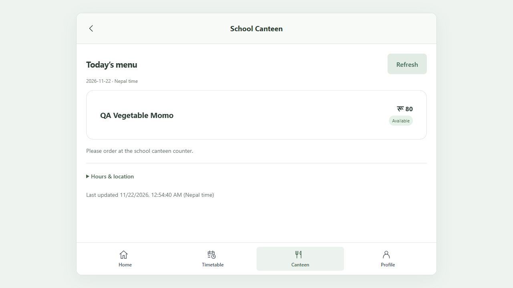

# Canteen head — menu workflow and test evidence

**Recorded run:** November 22, 2026 · **Runner:** Codex at Galan Bishal's request.  
[All roles](README.md) · [Full report](report.md) · [Administrator account setup](admin.md) · [Student reader](student.md) · [Parent reader](parent.md)

## Before signing in

The administrator creates a canteen-head account. The canteen head manages food information in its separate workspace; the administrator manages account access. This run used qa_canteen and fictional food/prices for the November 22 Nepal service date.

## Canteen steps

1. Sign in and open **Hours & location**. Enter school-approved identity/location and confirmed weekly hours; publish details and Save. The fixture used QA School Canteen, a fictional building location and Sunday–Friday 10 AM–4 PM.
2. Open **Daily menu**, check the exact service date and **Add food**. Enter the item name, NPR price and explicit availability. This run used QA Vegetable Momo, 80, Available.
3. **Save draft**, refresh the menu and sign in as student to confirm it is hidden. Saving a draft is different from publication.
4. Sign back in as canteen head and **Publish menu**. The student should see the same item and price after refresh.
5. Change availability to **Sold out** and **Save changes**. The student should see the label while name/price remain. Restore **Available**, save and verify again.
6. **Unpublish & save draft**. Student and parent readers should stop showing the menu. The recorded test intentionally ended in this state.

## Actually observed and limits

The date-specific draft, publication, sold-out/restoration and withdrawal sequence passed across the editor and student reader. The linked parent saw the same published menu and later its withdrawal. [Final database state](evidence/final-readback.json) confirms NPR and published=0. Published hours/location remain available.

[Role checks](evidence/role-read-checks.txt) rejected this account's administrator/teacher dashboard reads. This run does not certify all menu validation, date rollover, multi-day copying, stale concurrent edits or permission writes. Do not use a real active menu for a repeat test without an agreed fixture/window.

## Editor actions and reader verification screenshots

| Original step | Acting role | Observed screen/action | Screenshot |
| --- | --- | --- | --- |
| 29 | Canteen head | Canteen head first login with empty menu | [Picture 29](evidence/29-canteen-first-login.jpg) |
| 30 | Canteen head | Canteen identity and Sunday-Friday hours saved and published | [Picture 30](evidence/30-canteen-hours-published.jpg) |
| 31 | Canteen head | Menu saved as draft with fictional food at NPR 80 | [Picture 31](evidence/31-canteen-draft-saved.jpg) |
| 32 | Student | Student cannot see the saved unpublished menu | [Picture 32](evidence/32-student-draft-hidden.jpg) |
| 33 | Canteen head | Canteen head publishes the saved menu | [Picture 33](evidence/33-canteen-menu-published.jpg) |
| 34 | Student | Student sees published QA Vegetable Momo at NPR 80 | [Picture 34](evidence/34-student-published-menu.jpg) |
| 35 | Canteen head | Canteen saves published item as sold out | [Picture 35](evidence/35-canteen-sold-out.jpg) |
| 36 | Student | Student sees sold-out label without losing name and price | [Picture 36](evidence/36-student-sold-out.jpg) |
| 37 | Canteen head | Canteen restores availability | [Picture 37](evidence/37-canteen-availability-restored.jpg) |
| 38 | Student | Student sees restored available item | [Picture 38](evidence/38-student-availability-restored.jpg) |
| 45 | Parent | Observed parent canteen state during cross-role check | [Picture 45](evidence/45-parent-canteen-observed.jpg) |
| 46 | Canteen head | Canteen unpublishes menu back to draft | [Picture 46](evidence/46-canteen-withdrawn.jpg) |
| 47 | Student | Withdrawn menu disappears from student view | [Picture 47](evidence/47-student-withdrawn-hidden.jpg) |
| 48 | Parent | Withdrawn menu also hidden from parent | [Picture 48](evidence/48-parent-withdrawn-hidden.jpg) |

These links reuse the existing recorded run; writing this guide did not execute a new test. Cross-role rows identify the actual acting/reading role rather than attributing all actions to this guide’s role.
