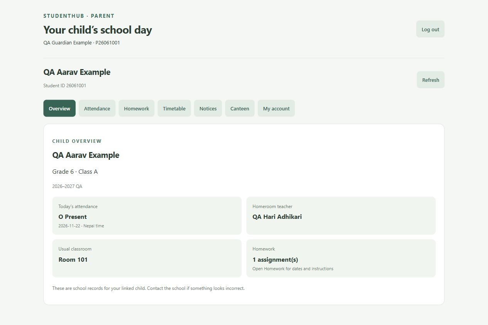

# Parent — linked-child workflow and test evidence

**Recorded run:** November 22, 2026 · **Runner:** Codex at Galan Bishal's request.  
[All roles](README.md) · [Full report](report.md) · [Administrator setup](admin.md) · [Teacher records](teacher.md)

Parent dashboard remains **stretch** in the final-demo plan. Testing it here does not add it to core release scope.

## Account creation and first login

1. The administrator verifies the guardian's authority and child's identity before creating/linking an account. The test used a fictional verified guardian QA Guardian Example, guardian@example.test, linked to QA Aarav Example. Login suggestion was P26061001; the verified link, not the P prefix, controls access.
2. Sign in with the privately supplied initial credentials. The recorded browser displayed **Set your own password** before exposing child records.
3. The required password transition was tested separately through the API: child read returned 403 before the change, a valid transition returned 200, then a new browser login reached the parent dashboard. This is **not** a browser-form password-change test. [Raw transition result](evidence/parent-initial-password-api.txt).

## Parent daily steps

4. Open **Overview**. The linked child should show the correct class, homeroom teacher, room, today's saved attendance and homework count. This run showed Grade 6 A, QA Hari Adhikari, Room 101, O Present and one assignment.
5. Open **Attendance**, choose the month and review marks/totals. November 22 showed O; Present total was 1 and absence/late/adjusted totals were zero.
6. Open **Homework** and **Timetable**. Compare the homework title/due date with the teacher's saved assignment and the child's class schedule.
7. Open **Canteen**. Published name/price/status should match the canteen editor; after withdrawal, no published menu should appear.
8. Open **My account** for own contact controls. Open **Notices** to read currently published school notices. QA school meeting appeared after the admin published it for that date.

## Observed result and limits

Initial-login protection, linked overview, attendance, homework, timetable, published/withdrawn menu, own-account view and notice read-back matched the recorded fictional setup. [Selected role checks](evidence/role-read-checks.txt) denied parent administrator/teacher dashboard reads; [post-restart checks](evidence/post-restart-role-reads.txt) passed again.

One parent/child was used. Multi-child switching, unlinked-child access, contact updates, disabled links and all date/error boundaries were not tested in this browser run. Those are not implied by the passing single-child views. Images are fictional, not real student or guardian information.

## Creation, parent actions and cross-role read-back screenshots

| Original step | Acting role | Observed screen/action | Screenshot |
| --- | --- | --- | --- |
| 39 | Admin | Fictional guardian linked to the child with admin verification | [Picture 39](evidence/39-parent-created.jpg) |
| 40 | Parent | Parent first login requires password change before viewing child | [Picture 40](evidence/40-parent-first-login-gate.jpg) |
| 41 | Parent | Parent sees only linked fictional child after required password transition | [Picture 41](evidence/41-parent-overview.jpg) |
| 42 | Parent | Parent monthly attendance shows saved O present and totals | [Picture 42](evidence/42-parent-attendance.jpg) |
| 43 | Parent | Parent sees teacher homework for linked child | [Picture 43](evidence/43-parent-homework.jpg) |
| 44 | Parent | Parent sees linked child timetable | [Picture 44](evidence/44-parent-timetable.jpg) |
| 45 | Parent | Observed parent canteen state during cross-role check | [Picture 45](evidence/45-parent-canteen-observed.jpg) |
| 48 | Parent | Withdrawn menu also hidden from parent | [Picture 48](evidence/48-parent-withdrawn-hidden.jpg) |
| 49 | Parent | Parent account screen limited to own contact details | [Picture 49](evidence/49-parent-account.jpg) |
| 50 | Admin | Admin publishes fictional school notice for today | [Picture 50](evidence/50-admin-notice-published.jpg) |
| 51 | Parent | Parent sees admin-published notice | [Picture 51](evidence/51-parent-notice-readback.jpg) |

These links reuse the existing recorded run; writing this guide did not execute a new test. Cross-role rows identify the actual acting/reading role rather than attributing all actions to this guide’s role.
