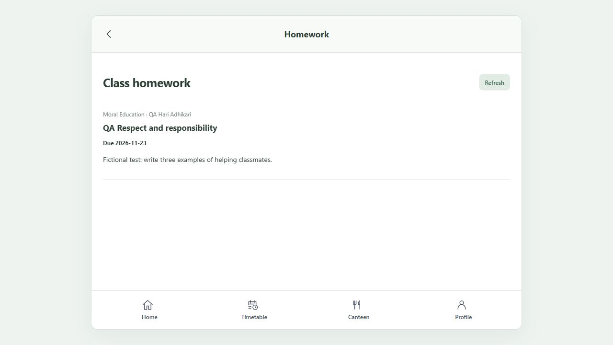

# Student — dashboard workflow and test evidence

**Recorded run:** November 22, 2026 · **Runner:** Codex at Galan Bishal's request.  
[All roles](README.md) · [Full report](report.md) · [Administrator setup](admin.md) · [Teacher workflow](teacher.md)

## Before signing in

The administrator creates the student account and effective class membership. Class/teacher/room and timetable information come from saved school planning, not from the student entering them. This run used fictional QA Aarav Example, test login 26061001, Grade 6 A. Credentials remain private.

## Student steps

1. Sign in and choose a Home feature or bottom navigation tab.
2. Open **My Class**. Confirm the school, Grade 6 A, homeroom teacher QA Hari Adhikari and Room 101.
3. Open **Timetable**. The same Sunday–Friday routine should be grouped without duplicating every identical day.
4. Open **Homework**. Read the teacher's saved title, instructions and due date. The recorded assignment was QA Respect and responsibility, due November 23.
5. Open **Canteen** and Refresh after changes made by the canteen head. An unpublished draft must stay hidden. Published QA Vegetable Momo appeared at NPR 80; Sold out preserved its name/price; Available returned after restoration. Withdrawal hid it again.
6. Open **Profile**, then **Show QR**. The run displayed the fictional identity and own card dialog. Staff authentication is still required for record lookup; opening the QR does not mark attendance.

## Observed result and limits

The selected own-class/timetable/homework reads and the canteen publication states matched the recorded setup. Student requests to administrator and teacher dashboard endpoints were rejected with 403 in the [read-only checks](evidence/role-read-checks.txt), including after restart.

The run used one student. It did not independently verify student-to-student isolation, contact edits, card download or camera scanning, nor every empty/error/retry state. Images contain fictional test identity only. The menu is left unpublished after the withdrawal test.

## Screenshot sequence

| Original step | Acting role | Observed screen/action | Screenshot |
| --- | --- | --- | --- |
| 24 | Student | New student signs in to own school dashboard | [Picture 24](evidence/24-student-home.jpg) |
| 25 | Student | Student sees own homeroom teacher, class and room | [Picture 25](evidence/25-student-class.jpg) |
| 26 | Student | Student timetable uses grouped Sunday-Friday routine | [Picture 26](evidence/26-student-timetable.jpg) |
| 27 | Student | Student sees homework assigned by teacher | [Picture 27](evidence/27-student-homework.jpg) |
| 28 | Student | Student sees no published menu before canteen setup | [Picture 28](evidence/28-student-menu-empty.jpg) |
| 32 | Student | Student cannot see the saved unpublished menu | [Picture 32](evidence/32-student-draft-hidden.jpg) |
| 34 | Student | Student sees published QA Vegetable Momo at NPR 80 | [Picture 34](evidence/34-student-published-menu.jpg) |
| 36 | Student | Student sees sold-out label without losing name and price | [Picture 36](evidence/36-student-sold-out.jpg) |
| 38 | Student | Student sees restored available item | [Picture 38](evidence/38-student-availability-restored.jpg) |
| 47 | Student | Withdrawn menu disappears from student view | [Picture 47](evidence/47-student-withdrawn-hidden.jpg) |
| 52 | Student | Student profile shows fictional identity and card actions | [Picture 52](evidence/52-student-profile.jpg) |
| 53 | Student | Student QR dialog generated for own identity | [Picture 53](evidence/53-student-qr.jpg) |

These links reuse the existing recorded run; writing this guide did not execute a new test. Cross-role rows identify the actual acting/reading role rather than attributing all actions to this guide’s role.
