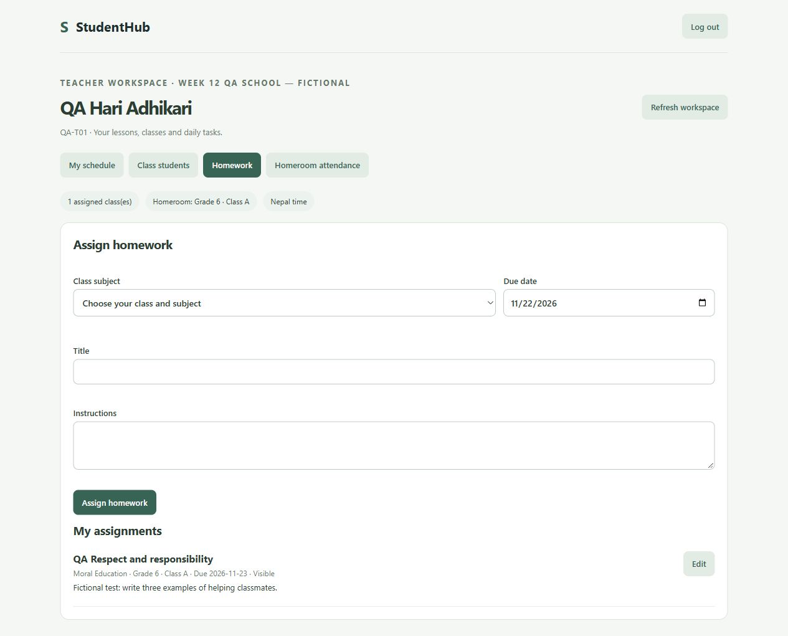

# Teacher — daily workflow and test evidence

**Recorded run:** November 22, 2026 · **Runner:** Codex at Galan Bishal's request.  
[All roles](README.md) · [Full report](report.md) · [Administrator setup](admin.md)

## Before signing in

The administrator must create a teacher record/login, link the teaching subject to a class/term, save its timetable and enroll students. Here qa_teacher belonged to fictional QA Hari Adhikari / QA-T01. Sunday 10 AM teaching makes this teacher the class's homeroom teacher; a teacher login alone does not grant every class's attendance access.

## Teacher steps

1. Sign in with the private teacher credentials. **My schedule** should show only this teacher's assigned lessons and the selected day. This run showed Moral Education, Grade 6 A, Room 101, 10:00–11:00.
2. Open **Class students**, choose the assigned class and check its roster. QA Aarav Example appeared with the generated fictional student ID.
3. Open **Homework**, choose the class subject, enter a title/instructions/due date and assign. This run saved QA Respect and responsibility, due November 23.
4. Open **Homeroom attendance**, choose class/month and select today's date. Set the student's mark and **Save selected day**, then **Refresh register**. This run saved O Present for November 22.
5. Verify the receiving roles: the student sees the saved homework; the linked parent sees the same homework and attendance. Their screenshots are read-back evidence, not additional actions performed as teacher.

## Observed result and limits

Schedule, roster, homework save and one attendance-day save/read-back passed. The parent register showed Present total 1. Symbols are O present, X absent, - late, E excused and · unmarked. Three lates count as one adjusted absence within the month, but that boundary was **not exercised in this browser run**.

[Teacher/student/parent raw read checks](evidence/role-read-checks.txt) and [post-restart checks](evidence/post-restart-role-reads.txt) passed their selected endpoints. This is not complete cross-class/privacy/concurrency verification or independent human testing.

## Screenshot sequence

| Original step | Acting role | Observed screen/action | Screenshot |
| --- | --- | --- | --- |
| 20 | Teacher | Teacher first login shows Sunday-Friday class schedule | [Picture 20](evidence/20-teacher-schedule.jpg) |
| 21 | Teacher | Teacher sees enrolled student in the assigned class | [Picture 21](evidence/21-teacher-roster.jpg) |
| 22 | Teacher | Teacher homework saved for Grade 6 A | [Picture 22](evidence/22-homework-assigned.jpg) |
| 23 | Teacher | Teacher saved O present for November 22 and refreshed register | [Picture 23](evidence/23-attendance-saved.jpg) |
| 27 | Student | Student sees homework assigned by teacher | [Picture 27](evidence/27-student-homework.jpg) |
| 42 | Parent | Parent monthly attendance shows saved O present and totals | [Picture 42](evidence/42-parent-attendance.jpg) |
| 43 | Parent | Parent sees teacher homework for linked child | [Picture 43](evidence/43-parent-homework.jpg) |

These links reuse the existing recorded run; writing this guide did not execute a new test. Cross-role rows identify the actual acting/reading role rather than attributing all actions to this guide’s role.
