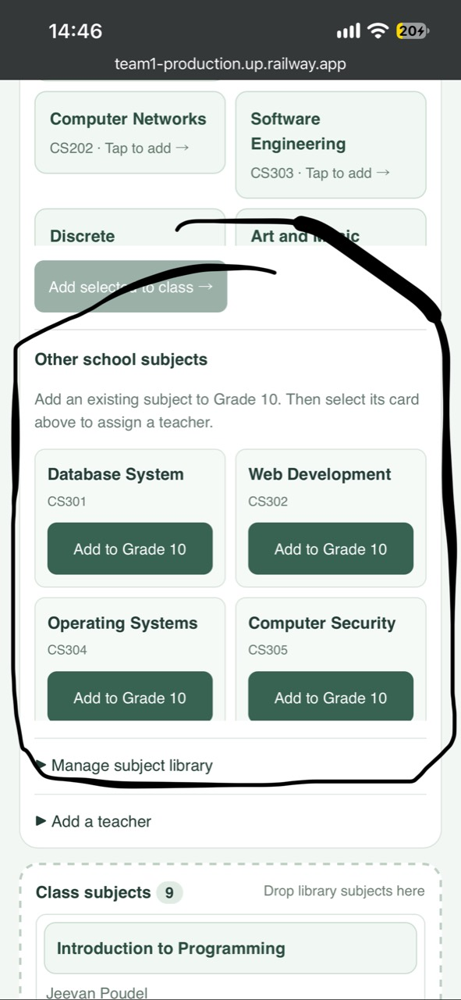

# Galan's mobile feedback — November 21, 2026

**Reporter:** Galan Bishal (@bishal482). Recorded from his direct reply in the project chat, with AI assistance organizing this note.

In response to the question about his completed iPhone comparison, Galan reported:

> the result was good. no error, i even reduced some list, making them appear only when i press it.

**Result:** user-reported success/no error in the mobile use he described. This confirms a personal feedback result; it is not an assistant-run or independent non-author test.

**Related implemented usability change:** [fd9cf3b](https://github.com/CapstoneDesign-Fall2026-UlsanCollege/Team1/commit/fd9cf3b) collapses Other school subjects on portrait phones behind Show list / Hide list. It resets closed when the class/year changes. The recorded implementation checks were a successful production build and 25 frontend regression tests, and the released asset contained the toggle. Those checks are separate from Galan's feedback.

## Screenshot supplied afterward

Galan supplied this screenshot in the project chat on November 21. It shows the deployed Railway site in portrait, with the expanded Other school subjects list and Add to Grade 10 controls circled. It documents the original usability problem that led to the list toggle. The image displays 14:46, but does not establish its capture date, deployed revision or test sequence. It is **before-change evidence**, not a screenshot of Show list / Hide list working and not subject-assignment persistence proof.

**Still not supplied:** exact test time/date, iPhone model/browser version, deployed revision, complete class/term context, tested subject/teacher combination, explicit refresh/read-back steps or an after-change screenshot. Consequently, this note does not establish a repeat of Moral Education / Hari Adhikari under the original conditions, diagnose the previous failure or prove every mobile flow passed.

Keep the original [Week 11 failure](../week11/ansh-iphone-subject-persistence.md), [Ansh's scoped retest](ansh-subject-persistence-retest.md) and [isolated API result](galan-qa-result.md) visible. Galan's completion checkbox remains preserved. Further exact-context evidence is an issue-closure detail to reconcile, not a reason to disregard his reported successful use.
