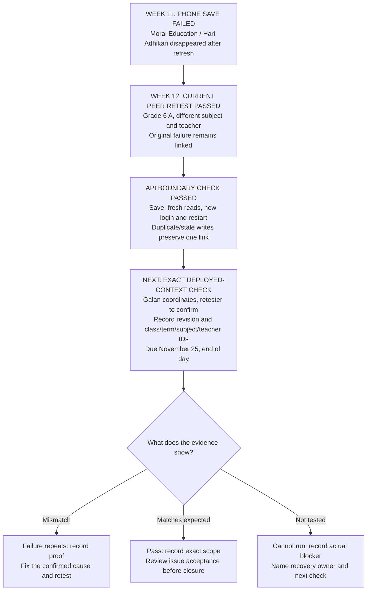

# Week 12 QA roadmap checkpoint

November 21, 2026. The [main project roadmap](../../roadmap.md) defines the feature promise; [Week 11 freeze](../week11/weekly-report.md#freeze-decision-and-next-route) still applies. This checkpoint updates the next QA action without changing scope.

Proof: [original failure](../week11/ansh-iphone-subject-persistence.md), [current peer result](ansh-subject-persistence-retest.md), [assistant API result](galan-qa-result.md), [issue #83](https://github.com/CapstoneDesign-Fall2026-UlsanCollege/Team1/issues/83), [shared report](weekly-report.md).

**Work order:** inherited P1 clean setup and live acceptance gaps (#77, #60/#65, hosted canteen acceptance) remain ahead of documentation polish. #83 exact-context follow-up is P2 after the current scoped pass; historical severity remains Major. Neither this ordering nor the local API all-clear declares the full MVP stable. Teacher dashboard remains core; parent dashboard and optional jobs are not new release gates.
