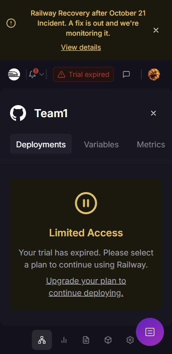

# StudentHub deployment outage and recovery record

**Date:** October 28, 2026 (Asia/Seoul)

**Owner:** Galan Bishal — `bishal482`

**Tracking:** [#65 — verified release milestone](https://github.com/CapstoneDesign-Fall2026-UlsanCollege/Team1/issues/65), [C0 #61](https://github.com/CapstoneDesign-Fall2026-UlsanCollege/Team1/issues/61)

## Current result: blocked by hosting restriction

The public URL `https://team1-production.up.railway.app/` returns HTTP 404 with `Application not found`. On the authenticated Team1 service page, the assistant subsequently observed:

- **Trial expired**.
- **Limited Access — Your trial has expired. Please select a plan to continue using Railway.**
- **Service offline**.
- **There is no active deployment for this service.**

This establishes a current hosting restriction and inactive service. It is not proof of a frontend search bug or a failed application build. The exact trial/credit history, database state and latest deployed commit have not been verified. A general Railway incident banner was also visible; this record does not attribute this service's outage to that separate incident.

## Evidence and timeline

| Check | Actual observation | Evidence / limit |
|---|---|---|
| October 25 local C0 implementation | Local role checks and build passed. | [C0 note](c0-test-note.md); did not establish live deployment. |
| October 28 public HTTP check | HTTP 404, `Application not found`. | [Recorded response](evidence/railway-http-check-2026-10-28.txt). Initially insufficient to determine the cause. |
| October 28 authenticated Railway inspection | Trial expired; limited access; service offline; no active deployment. | [Dashboard screenshot](evidence/railway-trial-expired-2026-10-28.png). This is the later confirmed blocker. |

The [dashboard observation record](evidence/railway-dashboard-observation-2026-10-28.txt) records the service-status text read from the accessibility tree. The narrow screenshot directly shows the trial/limited-access notice.

## Recovery actions — not yet completed

1. **Owner: `bishal482`.** Choose whether to restore the Railway plan or approve a move to a different host. Any paid plan or payment must be performed/approved by the account owner; none was initiated by the assistant.
2. After hosting access is restored, inspect the service and MySQL availability. Record whether the database still exists and its recovery options; do not delete, recreate or reseed real academic data to make a demo work.
3. Deploy a published commit containing C0, record its exact SHA and successful startup logs, and confirm the correct public domain points to the active service. Do not deploy unpublished menu/room/teacher drafts as if they are verified.
4. Check that the public login page loads. HTTP 200 alone is insufficient: verify approved administrator/student login and the existing academic/job path.
5. With approved test records, verify canteen-head provisioning, login, reload, permissions, disable and revoked-session behaviour. Keep passwords/cookies out of evidence.
6. Ask a real non-author to complete the [C0 procedure](c0-independent-test.md). Record tester, actual date, environment/commit, expected/actual results, first failure and safe proof.
7. Update the [shared report](weekly-report.md), checklist, #61 and #65 from actual results. Keep the MVP verification gap until these checks pass.

## Completion checklist

- [x] Public failure recorded.
- [x] Authenticated dashboard blocker identified and screenshot linked.
- [x] Owner and next actions recorded.
- [ ] Hosting decision made by the owner.
- [ ] Service/database access restored and state checked.
- [ ] Published commit deployed; exact version linked.
- [ ] Live login/provisioning/role checks recorded.
- [ ] Non-author C0 result recorded.

## Honest fallback for this Week 8 submission

Use the published C0 source, dated screenshots, local test note and [fictional-account review fixture](../../backend/scripts/c0-review.mjs) as bounded evidence. These remain reviewable while hosting is unavailable. They do not turn the outage into a passed live test or replace a teammate's result.
