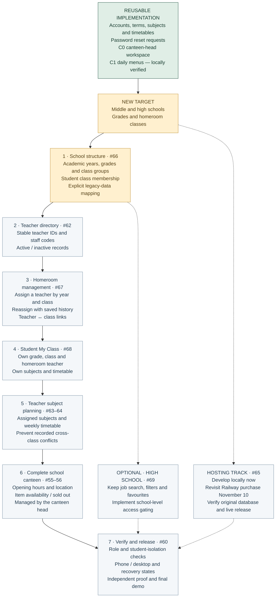

# StudentHub — revised school roadmap

**Updated:** November 1, 2026 · [Design Doc v2](design-doc-v2.md)

Classroom finding is cancelled. Homeroom classes mean student groups, not physical rooms. Job search remains optional for high-school users; its new audience gating is planned.

Green means existing implementation, not a complete new school release. Gold identifies the new direction and next implementation. Grey items remain planned. C1 still needs browser/manual proof and live checking. Render/Aiven deployment history does not prove the original Railway database has been recovered.

Cancelled as **not planned**, not completed: [#51](https://github.com/CapstoneDesign-Fall2026-UlsanCollege/Team1/issues/51), [#57](https://github.com/CapstoneDesign-Fall2026-UlsanCollege/Team1/issues/57), [#58](https://github.com/CapstoneDesign-Fall2026-UlsanCollege/Team1/issues/58), [#59](https://github.com/CapstoneDesign-Fall2026-UlsanCollege/Team1/issues/59).
