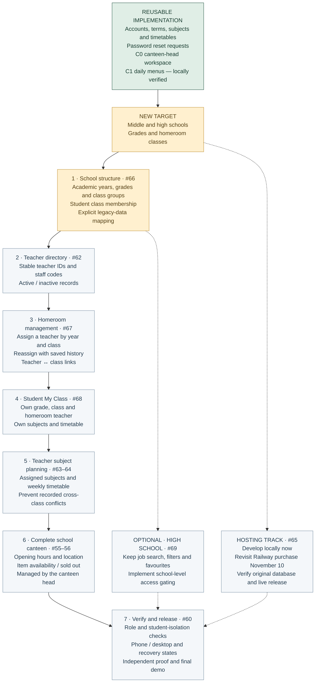

# StudentHub — revised school roadmap

> Historical checkpoint. See the [current Week 11 roadmap](../week11/roadmap.md), updated November 12, 2026; teacher dashboard is stretch scope.
**Updated:** November 3, 2026 · [Design Doc v2](design-doc-v2.md)

StudentHub primarily supports school administration in Nepal. Each class has a usual classroom; shared labs and activity rooms have day/time bookings. The earlier general classroom-finder scope remains cancelled. Homeroom classes are student groups, separate from physical rooms. Job search remains optional for high-school users; its new audience gating is planned.

Green means existing implementation, not a complete new school release. Gold identifies the new direction and next implementation. Grey items remain planned. C1 still needs browser/manual proof and live checking. Render/Aiven deployment history does not prove the original Railway database has been recovered.

Cancelled as **not planned**, not completed: [#51](https://github.com/CapstoneDesign-Fall2026-UlsanCollege/Team1/issues/51), [#57](https://github.com/CapstoneDesign-Fall2026-UlsanCollege/Team1/issues/57), [#58](https://github.com/CapstoneDesign-Fall2026-UlsanCollege/Team1/issues/58), [#59](https://github.com/CapstoneDesign-Fall2026-UlsanCollege/Team1/issues/59).

## November 3 scope clarification — room allocation board

The owner approved a different room workflow: five floors with eight rooms each. Rooms ending in 07 and 08 are special rooms (10 total); the remaining 30 are usual classrooms. Administrators drag a class onto a room: a regular room gets a year-scoped class assignment, while a special room opens a day/time booking form. This is a local implementation, not a live release or a completion claim for the cancelled historical Issues above.

Locally implemented: editable room names, usual-classroom moves/releases, one-time and weekly special-room bookings, and room/class/teacher booking conflicts with stale-write protection. Details and proof: [Room board test note](room-board-test-note.md). No production data migration or Railway deployment has been performed.

Homeroom rule clarified November 2: the teacher of Sunday’s 10 AM lesson in a selected term is shown as the homeroom teacher in Accounts. This is derived from the subject timetable; the earlier separate manual-assignment/history plan is not implemented by that view.
