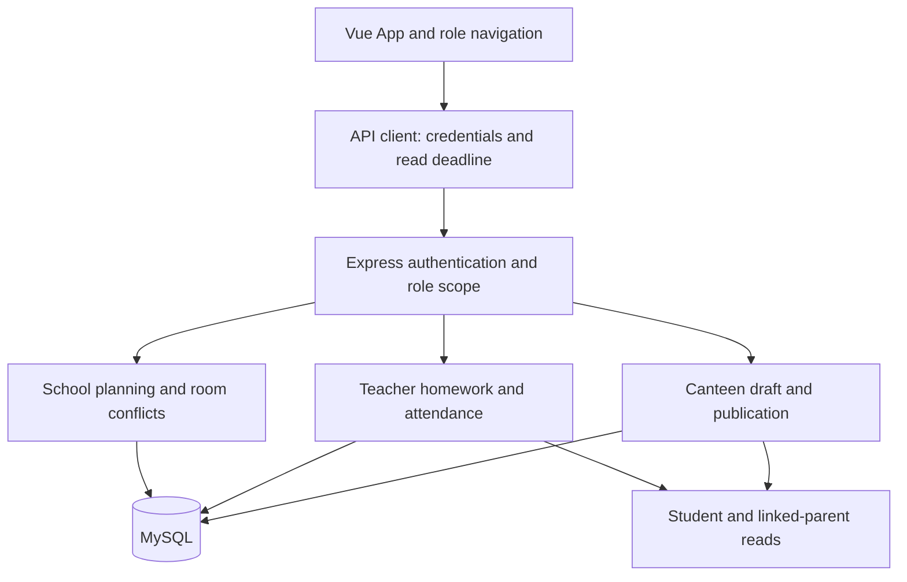

# Architecture and handoff

[README](../README.md) → [setup](setup-guide.md) → relevant check below. The [existing audit area map](../classroom/week10/ai-use-and-code-ownership-audit.md#codebase-area-map--current-source-of-truth) remains the single stewardship map. [Week 13 addendum](../classroom/week13/ai-use-and-code-ownership-audit.md) adds evidence without assigning new stewards.

| Boundary | Source | Check |
| --- | --- | --- |
| Navigation/dirty forms | `WorkspaceNav.vue`, `ParentWorkspace.vue`, `CanteenWorkspace.vue` | [Local workflow](../classroom/week13/verification.md) |
| Read timeout | `frontend/src/safe-read.ts`, `api.ts` | `frontend/tests/safe-read.test.mjs`; [output](../classroom/week13/evidence/frontend-tests.txt) |
| Authentication/student scope | `backend/src/database-app.ts`, `school-planning.ts` | `backend/tests/school-planning.test.mjs`; [output](../classroom/week13/evidence/school-planning-tests.txt) |
| Timetable/rooms | `backend/src/school-planning.ts`, `school-rooms.ts` | Same suite: conflict and transaction checks |
| Homework/attendance | `backend/src/teacher-workspace.ts` | Same suite; [workflow guide](teacher-daily-workflow.md) |
| Menu publication | `backend/src/canteen-menu.ts`, `DailyMenu.vue` | Same suite and [local receipt](../classroom/week13/verification.md) |
| Hosted build | `Dockerfile`, `railway.json` | [Deployment](deployment.md) |

Cross-area dependency: teacher homework saves preserve class/offering/teacher identity before student/parent reads can expose them. A toast alone does not establish persistence: check a fresh role read. Parent secondary notices/menu failures leave main child records usable. GET requests have a 20-second deadline; writes are not automatically aborted or replayed because a save may already have reached the server.

If a support person is unavailable, use the audit contacts and source/check links above. Another teammate can run the isolated suite and record command, revision and exact observation. Proposed backups remain proposed until accepted; no private walkthrough or dump is required.

Normal startup extends a provisioned schema. The review harness constructs a fictional base schema; it is a bounded demonstration, not permanent install proof. [Current actions](../classroom/week13/issues-and-reminders.md).
