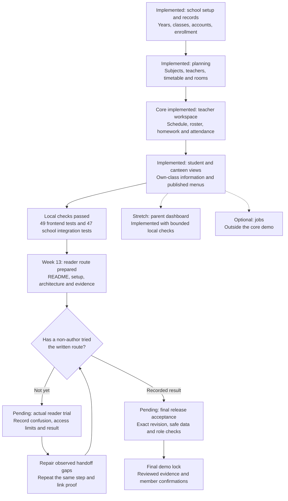

# StudentHub roadmap

Updated November 28, 2026. Team 1. [README](README.md) | [Handoff package](classroom/week13/final-handoff.md) | [Fixed final-demo promise](classroom/final-demo-roadmap.md#final-demo-promise)

StudentHub connects school administration, teaching and student information. The teacher dashboard is core. Parent dashboard and jobs remain stretch/optional. Feature scope is frozen while we verify the existing promise.

## From working features to a trustworthy handoff

Each box says its status; colour is not needed to understand the route.

## What is complete and what remains

| Stage | Status and proof | Next action |
| --- | --- | --- |
| School, teacher, student and canteen workflows | Implemented; [feature list](classroom/week13/final-feature-list.md), [historical role proof](classroom/week12/bishal_check/README.md) | Latest-release human acceptance |
| Shared navigation, draft protection and read recovery | [b258c29](https://github.com/CapstoneDesign-Fall2026-UlsanCollege/Team1/commit/b258c29), [local verification](classroom/week13/verification.md) | Repeat critical tasks on real device |
| README/setup/architecture | [Week 13 index](classroom/week13/README.md) | Non-author follows instructions without private coaching |
| Permanent fresh installation | Limited: baseline/first-admin absent in this checkout; historical #77 closed | Reconcile missing artifacts and clean-install proof |
| Independent handoff | Pending [actual peer result](classroom/week13/peer-test-notes.md) | Galan coordinates volunteer by December 2 end of day |
| Hosted release | [Release receipt](classroom/week13/release.md) | Deployment health is separate from complete role acceptance |
| Final demo | Pending acceptance and personal confirmation | Lock revision and safe starting state; no new feature promise |

## Risks and fallback

The disposable local fixture is a documented demonstration route, not proof of a permanent empty-database installation. No permanent-install fallback is verified. If a reader cannot run it, record the access limit and permitted read/understand result. Do not convert an unrun check into a pass. [Issue definitions, owners and reminders](classroom/week13/issues-and-reminders.md).

[#77](https://github.com/CapstoneDesign-Fall2026-UlsanCollege/Team1/issues/77) and [#83](https://github.com/CapstoneDesign-Fall2026-UlsanCollege/Team1/issues/83) are now closed in GitHub. Preserve their historical records; do not infer current-revision acceptance from closure alone.

[Week 11 freeze](classroom/week11/weekly-report.md) and [Week 12 QA](classroom/week12/galan-qa-result.md) explain earlier evidence. [Final Demo Roadmap](classroom/final-demo-roadmap.md) retains the promise and milestone history. [Single area map](classroom/week10/ai-use-and-code-ownership-audit.md#codebase-area-map--current-source-of-truth) remains the support source, without duplicate ownership lists.
