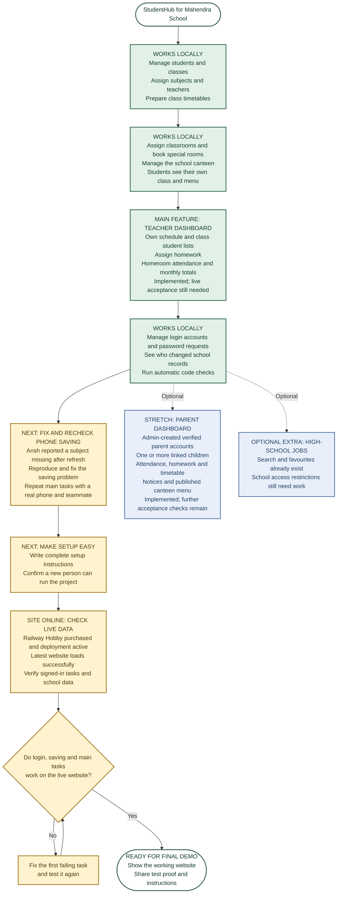

# StudentHub — current project roadmap

**Team:** Team 1 · **School:** Mahendra School
**Updated:** November 16, 2026 · **Owner:** Galan Bishal, with coding assistance
**Direction:** Nepal middle/high-school administration. This supersedes the [Week 9 plan](classroom/week9/roadmap.md) and [Week 10 checkpoint](classroom/week10/roadmap.md).

## Week 11 MVP verification and freeze gate — November 18, 2026

**Team decision:** feature scope is frozen. The team is following the recovery/acceptance route rather than declaring the complete MVP stable.

- [Shared Week 11 weekly report](classroom/week11/weekly-report.md)
- [MVP verification checklist](classroom/week11/mvp-verification.md)
- [Week 11 one-pager response](classroom/week11/one-pager.md)
- [Week 11 work checklist](classroom/week11/work-checklist.md)

The latest daily-workflow integration suite recorded 94 backend checks passing with zero failures/skips in isolated MySQL fixtures. However, Ansh's deployed iPhone subject-assignment test failed after refresh; canteen manual acceptance, fresh-clone setup, and full independent live role acceptance remain open. These are release gates, not reasons to expand feature scope.

## Project flowchart

Read from top to bottom. Each arrow means **the next step**. Green boxes already work on our laptop; yellow boxes still need finishing; blue boxes are optional. Text labels carry the same meaning as the colours.

**Teacher dashboard is main-release work.** Its schedule, class roster, homework and attendance belong in the required final demo. **The parent dashboard is stretch work:** already implemented, with its remaining acceptance checks tracked separately. This priority change preserves all existing code and records.

**Current position (Week 11 freeze gate, November 18):** the Railway site is online and the daily cross-role workflow suite has 94 passing backend checks in isolated MySQL fixtures. The complete MVP is not yet accepted: the deployed iPhone subject-assignment persistence check failed after refresh, while canteen manual acceptance, fresh-clone setup and full independent authenticated live role checks remain. Feature scope is frozen; recover and verify these existing promised behaviors before final-demo readiness. See the [shared Week 11 report](classroom/week11/weekly-report.md), [MVP checklist](classroom/week11/mvp-verification.md) and [deployment proof](classroom/week11/railway-deployment-2026-11-12.md).

<strong>Open technical details, evidence and issue links</strong>

## Completed implementation

| Area | What exists now | Evidence / issues |
|---|---|---|
| School structure | Academic years, grades/classes, dated membership and transfers with explicit legacy mapping | [School checks](classroom/week10/school-release-check.md), #66 |
| Student accounts | Class-aware creation; compact combined profile/login editor, automatic admission-ID prefix, individual ID change without changing password or linked records | [Account checks](classroom/week10/student-login-id-check.md), #74/#82 |
| Academic planning | Admin teacher directory, staff IDs, subject filter, subject/teacher assignment, Sunday–Friday timetable and recorded conflicts | [School workspace](classroom/week10/school-workspace-usability.md), #62–64/#75 |
| Homeroom display | Derived from the selected term's Sunday 10 AM teacher, shown to admin/student; ambiguity and missing assignment are explicit | [Student checks](classroom/week10/student-dashboard-check.md), #67/#68/#76 |
| Rooms | Configurable floors and room numbers, initial five-floor/40-room layout, usual classroom assignments, same-day special-room bookings and room/class/teacher conflicts | [Room verification](classroom/week10/room-booking-assistant-check-2026-11-10.md), #72 |
| School canteen | Separate canteen-head account/workspace, menus, rupee prices, selected-date copying, skip existing dates, publication, hours/location and availability | [Canteen proof](classroom/week10/canteen-owner-check.md), [shortcuts](classroom/week10/canteen-menu-shortcuts-check.md), #54–56/#61 |
| Student experience | Feature-tab Home, own class/teacher/room, grouped repeated timetable and published canteen information | [Student proof](classroom/week10/student-dashboard-check.md), #76 |
| Support and history | Administrator-reviewed password requests with private manual delivery; staff Activity Log with sensitive-value redaction | [Activity Log proof](classroom/week10/activity-log-check.md), #49/#73 |
| Testing | Existing node:test runner, local tests/builds, controlled failure check and GitHub Actions | [Week 11 testing guide](classroom/week11/automated-testing-guide.md), [CI proof](classroom/week11/testing-evidence.md), #84 closed |
| Mobile follow-up | Tap-to-assign subjects, Add lesson without drag, compact text; successful 390px assignment/save/reload and 320px dialog fit | [Actual verification](classroom/week11/issue-verification-2026-11-12.md), #83 physical-phone check pending |

The original separate manual homeroom assignment/history design is **not** implemented by the timetable-derived display. Teacher specialization and the repeated five-period routine are current sample-data choices, not a fully enforced national curriculum or qualification policy.

## What we will finish next

| Priority | Work and definition of finished | Owner | Issue |
|---|---|---|---|
| 1 | Repeat subject assignment, popup save/cancel, conflict handling and normal scrolling on a physical phone; record device/browser, commit and actual results | Galan Bishal | [#83](https://github.com/CapstoneDesign-Fall2026-UlsanCollege/Team1/issues/83) |
| 1 | A real non-author repeats a valid room booking and overlap rejection; verify own-class isolation and canteen publication privacy; record expected/actual and safe proof | Galan coordinates; tester must personally confirm | [#72](https://github.com/CapstoneDesign-Fall2026-UlsanCollege/Team1/issues/72), #60 |
| 1 | Review remaining feature criteria, configured school data, hours/prices, inactive/missing states and recovery behavior; fix observed failures rather than assume tests cover every screen | Galan + school/canteen operator confirmation | #54–56/#62–68/#70/#73–76/#82 |
| 2 | Publish baseline/migration order and private configuration, first-admin steps; reproduce from a clean clone and empty isolated database | Galan Bishal | [#77](https://github.com/CapstoneDesign-Fall2026-UlsanCollege/Team1/issues/77) |
| 3 | Use the chosen Railway Hobby host; record the deployed commit and prove authentication, permissions and saved read-back across the full main workflow | Galan Bishal | [#65](https://github.com/CapstoneDesign-Fall2026-UlsanCollege/Team1/issues/65) |
| 4 | Rehearse the core demo, update one shared report and confirmed personal contributions, document remaining limitations, and publish final release evidence | Team members confirm their own parts; Galan coordinates | [#60](https://github.com/CapstoneDesign-Fall2026-UlsanCollege/Team1/issues/60) |

Galan confirmed the Railway Hobby purchase on November 12. The GitHub-connected deployment is now active and public HTML/assets return **200**. Later data migration and authenticated route checks are recorded in Week 11; full role-by-role live acceptance still needs checking. The earlier **404** is historical; [recovery evidence](classroom/week11/railway-deployment-2026-11-12.md) records the change. A Pages build alone is not a working backend deployment.

## Teacher dashboard — main release

**Moved into the main release at Galan's request on November 16.** Personal schedule, class rosters, homework and attendance are required main-demo features. Their remaining live and independent acceptance checks must be included in the release review.

| Main teacher feature | Current state | Before claiming final completion |
|---|---|---|
| Teacher accounts, personal schedule and assigned-class roster (#78) | Implemented and locally checked | Independent/hosted role and isolation check |
| Teacher homework and student homework view (#79) | Implemented and locally checked | Non-author create/edit/archive and student read-back |
| Homeroom attendance (#80) | Implemented and locally checked | Non-author authorization, save and reload |
| Monthly attendance register (#81) | Implemented and locally checked; O present, X absent, - late; adjusted absence adds floor(lates/3) within month | Independent review of totals, membership/date boundaries and live persistence |

[Teacher evidence](classroom/week10/teacher-workspace-check.md) · [Monthly attendance evidence](classroom/week10/monthly-attendance-check.md). No original late marks are rewritten. These implemented main features are not yet claimed independently accepted.

## Stretch section — parent dashboard

The parent dashboard is implemented but optional for the main final demo. Administrators create P-prefixed accounts and verified child links. Parents can switch between linked children and view attendance, homework, timetables, notices and published canteen menus. Initial passwords must be changed; parents can update their own contact details.

Galan reported creation/login, unlinking and child switching passed. Independent/physical-phone and full hosted workflow checks remain separate. [Implementation and evidence](classroom/week11/parent-workspace.md) · [#99](https://github.com/CapstoneDesign-Fall2026-UlsanCollege/Team1/issues/99). These remaining parent checks do not block the main release.

## Optional high-school feature

Job search, filters and favourites already exist. [#69](https://github.com/CapstoneDesign-Fall2026-UlsanCollege/Team1/issues/69) still needs server-enforced high-school/setting access controls. Retain code/data; do not present this as an approved middle-school workflow or a blocker to the administration demo.

## Final core demo path

1. Administrator opens a grade/class, reviews students, teacher assignments and weekly timetable.
2. Saves a valid special-room booking, reloads it and shows a conflicting booking rejected.
3. Teacher opens their schedule and class roster, assigns homework, saves homeroom attendance and reviews monthly totals.
4. Student opens their own class, homeroom teacher, timetable, homework and published canteen menu.
5. Canteen head changes approved fictional menu availability; student refresh confirms it.
6. Show the exact test/CI and human proof, followed by live read-back results. Demonstrate the parent dashboard only as an optional stretch feature if time allows.

## Current evidence and limits

The latest [daily workflow verification](classroom/week11/daily-workflow.md) records **94 backend passes**, including admin enrollment, teacher homework/attendance, student/parent read-back and canteen publication. These are assistant-run isolated-database tests. [Ansh's deployed iPhone check](classroom/week11/ansh-iphone-subject-persistence.md) reported a subject missing after refresh; that failure still needs diagnosis and a recorded retest.

The [November 12 verification](classroom/week11/issue-verification-2026-11-12.md) records 78 backend passes with all isolated DB suites enabled, 17 frontend passes, successful build, actual phone-width subject save/reload/conflict checks and the live 404. Those are historical assistant-run local checks, superseded for current automated totals and public availability by the later records above. Independent acceptance remains separate from automated passes. An implemented feature may still have an open issue because its remaining acceptance criteria are not met.

